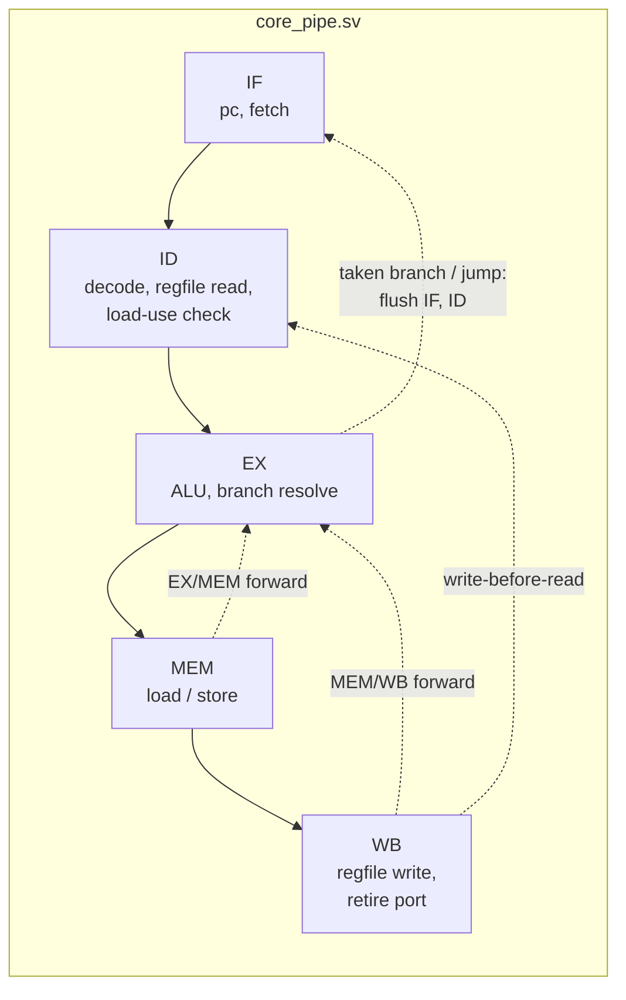

# rv32i-core-verif

[](https://github.com/ido55/rv32i-core-verif/actions/workflows/ci.yml)

Two RV32I CPUs in SystemVerilog, a single-cycle core and a 5-stage pipeline with
forwarding, load-use stalls and branch flush, verified instruction by instruction against
a Python golden model with cocotb + Verilator: directed tests, the official riscv-tests,
constrained-random programs, and functional coverage.

> **Status:** Milestone 4 of 5 (pipelined core). See [ROADMAP.md](ROADMAP.md).
> Every number below was measured, and the command that produced it is shown next to it.

## Quick start

```bash
git clone --recursive https://github.com/ido55/rv32i-core-verif.git   # --recursive: riscv-tests submodule
cd rv32i-core-verif
```

With Docker (no local toolchain needed):

```bash
docker build -t rv32i-core-verif .
docker run --rm rv32i-core-verif          # runs: make lint test
```

Natively on Ubuntu 24.04 / WSL2:

```bash
sudo apt install build-essential python3-venv python3-dev verilator gcc-riscv64-unknown-elf
make venv        # .venv with pinned cocotb / pytest / ruff
make lint        # ruff + verilator --lint-only -Wall
make test        # golden-model tests + RTL tests on both cores
make coverage    # functional coverage of the last test run
make cpi         # CPI of fibonacci and bubble sort on both cores
make test-random CORE=pipe SEEDS=500   # more random programs on one core
make mutation    # inject 7 pipeline bugs one at a time, count failing tests (~5 min)
```

## Architecture



| Hazard | How core_pipe.sv handles it | Cost |
|---|---|---|
| ALU result needed 1 or 2 instructions later | forward from EX/MEM or MEM/WB into EX (EX/MEM wins: newer) | 0 cycles |
| Value written back while ID reads it | write-before-read bypass in ID | 0 cycles |
| Load result needed by the next instruction | stall IF/ID 1 cycle, bubble into EX, then forward from MEM/WB | 1 cycle |
| Taken branch, JAL, JALR | predict not taken; resolve in EX; flush IF and ID | 2 cycles |
| ECALL / EBREAK / illegal | flush younger instructions in EX and stop fetching | — |

Both cores share the decoder, ALU, branch unit, load/store unit and register file
(`rtl/`), and expose the same **retire port**, so every test runs on both, unchanged.

## How the cores are checked

```mermaid
flowchart LR
    P[program words] --> IM[imem / dmem<br/>tb_top.sv] --> C[core_single.sv<br/>or core_pipe.sv]
    P --> ISS[Python ISS<br/>model/iss.py]
    C -- retire port, every instruction --> SB{scoreboard<br/>tb/harness.py}
    ISS -- Iss.step&#40;&#41; Retire record --> SB
    SB -- at halt --> F[compare all 31 registers<br/>and all of data memory]
```



The retire port (modelled on the RISC-V Formal Interface) reports every completed
instruction: pc, instruction, next pc, register written, load/store address, byte masks and
store data. The testbench steps the ISS once per retired instruction and compares the two
records, so a bug is reported at the first instruction where core and model disagree,
with the instructions before it as context:

```
ScoreboardMismatch: retire #287 mismatch at pc=0x00000478: bge x19, x19, .+8
  next_pc    core=0x0000047c  model=0x00000480
```

The golden model is checked independently first: hand-computed tests per instruction, the
encoder against GNU `as` on 1,600 random instructions, and the official rv32ui riscv-tests.

## Results

### Tests

Measured with `make test` (CI runs the same on every push):

| Suite | What it checks | single | pipe |
|---|---|---|---|
| `tests/model` | ISS unit tests, encoder vs GNU `as`, **rv32ui riscv-tests on the ISS**, C programs and 200 random programs on the ISS, coverage collector | 429 / 429 (core-independent) | |
| `test_alu.py`, `test_regfile.py` | ALU (edge pairs + 1,000 random pairs per op), register file (2,000 random cycles) | 7 / 7 (shared blocks) | |
| `test_core_directed.py` | every RV32I instruction with edge cases, x0, halt, illegal trap, 5 hazard tests | 50 / 50 | 50 / 50 |
| `test_core_programs.py` | **official rv32ui riscv-tests** (40 of 42) + fibonacci + bubble sort | 42 / 42 | 42 / 42 |
| `test_core_random.py` | constrained-random programs, seeds 1-50 (~360 instructions each) | 50 / 50 | 50 / 50 |

Excluded riscv-tests: `fence_i` (self-modifying code) and `ma_data` (misaligned access),
both outside this design's scope. One-off sweeps of 2,000 more seeds passed on both cores
(`make test-random CORE=<core> SEED_START=1000 SEEDS=2000`; see [docs/bugs.md](docs/bugs.md)).

### Performance (CPI)

Measured with `make test && make cpi`:

| Program | Core | Instructions | Cycles | CPI | Load-use stall cycles | Flushes |
|---|---|---|---|---|---|---|
| bubble_sort | single | 3,639 | 3,639 | 1.000 | - | - |
| bubble_sort | pipe | 3,639 | 5,803 | 1.595 | 496 | 833 |
| fibonacci | single | 14,799 | 14,799 | 1.000 | - | - |
| fibonacci | pipe | 14,799 | 17,147 | 1.159 | 0 | 1,173 |

Every pipeline cycle is accounted for, and a test enforces it:
`cycles = instructions + 4 (fill) + stall cycles + 2 × (flushes − 1)`; for bubble sort,
3,639 + 4 + 496 + 2 × 832 = 5,803. Bubble sort's data-dependent branches are taken often
(each costs 2 cycles with predict-not-taken), and its compare loads values right before
using them; GCC's code for recursive fibonacci has no load-use pairs at all. CPI is per
clock cycle; the pipeline's advantage is a shorter clock period, which M5 estimates with
synthesis.

### Functional coverage

Measured with `make test && make coverage` (sampled from every retired instruction, plus
every clock cycle of the pipeline's hazard logic):

| Coverpoint | Bins | single | pipe |
|---|---|---|---|
| opcode | 40 | 100% | 100% |
| branch taken / not taken | 12 | 100% | 100% |
| load / store width × byte offset | 20 | 100% | 100% |
| x0 as rd / rs1 / rs2 | 3 | 100% | 100% |
| immediate sign per format | 8 | 100% | 100% |
| read-after-write distance 1-3, load-use | 7 | 100% | 100% |
| pipeline: each forwarding path, newest-wins, bypass, stall, 4 flush causes | 13 | — | 100% |
| **total** | | **90 / 90** | **103 / 103** |

Random tests alone reach 88 / 90 and 101 / 103: they never produce EBREAK (programs end
with ECALL) or a backward JAL (jumps only go forward, so every program terminates); the
directed tests cover both.

### Can the tests find bugs? (mutation analysis)

No RTL bug has been found yet, so `make mutation` checks the tests themselves: it injects
7 classic pipeline bugs, one at a time, and counts failing tests (failing / run):

| Injected bug | Directed | Programs | Random |
|---|---|---|---|
| No EX/MEM forwarding (rs1) | 43 / 50 | 41 / 42 | 50 / 50 |
| No MEM/WB forwarding (rs2) | 6 / 50 | 11 / 42 | 50 / 50 |
| Forwarding priority wrong (MEM/WB beats EX/MEM) | 9 / 50 | 27 / 42 | 49 / 50 |
| Forwarding from x0 | 1 / 50 | 16 / 42 | 9 / 50 |
| No write-before-read bypass | 21 / 50 | 36 / 42 | 50 / 50 |
| No load-use stall | 2 / 50 | 7 / 42 | 35 / 50 |
| Flush squashes only IF, not ID | 50 / 50 | 42 / 42 | 50 / 50 |

All 7 are caught by every suite. The first run of this analysis found that the directed
tests missed "forwarding from x0" entirely (0 / 45); the 5 hazard tests were added because
of it. Details and the bugs found so far are in [docs/bugs.md](docs/bugs.md).

## Layout

| Path | Contents |
|---|---|
| `rtl/` | `rv32i_pkg`, `alu`, `regfile`, `decoder`, `branch_unit`, `lsu`, `core_single`, `core_pipe` |
| `model/` | Python golden model: instruction table, encoder/decoder, reference ALU, ISS |
| `tb/` | `tb_top.sv` (core + 16 KiB memories), `harness.py` (scoreboard), random generator, coverage, program builds, reports |
| `programs/` | C programs (fibonacci, bubble sort), `crt0.S`, linker script, minimal riscv-tests environment |
| `third_party/riscv-tests` | official RISC-V ISA tests, git submodule pinned to `d7e86f7` |
| `tests/model/`, `tests/rtl/` | pytest for the golden model; cocotb testbenches launched from pytest |
| `tools/mutation_analysis.py` | `make mutation` |
| `docs/bugs.md` | bug log: real bugs, and injected bugs used to prove the tests can fail |

## License

[MIT](LICENSE)
