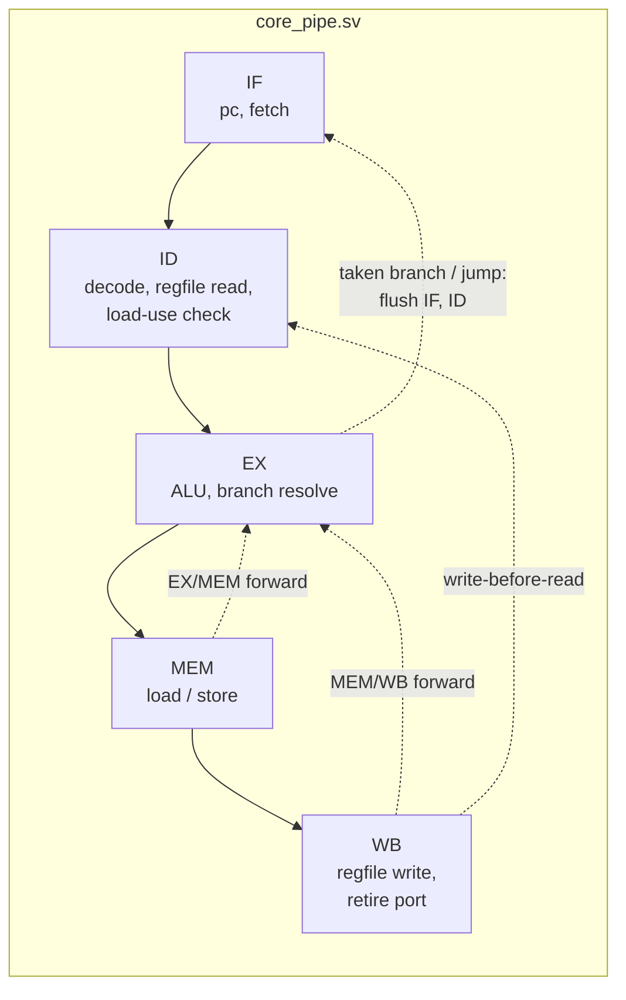
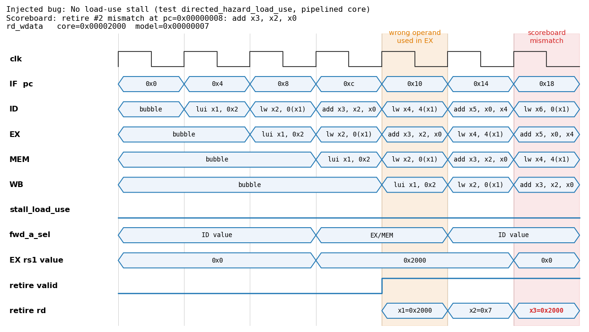
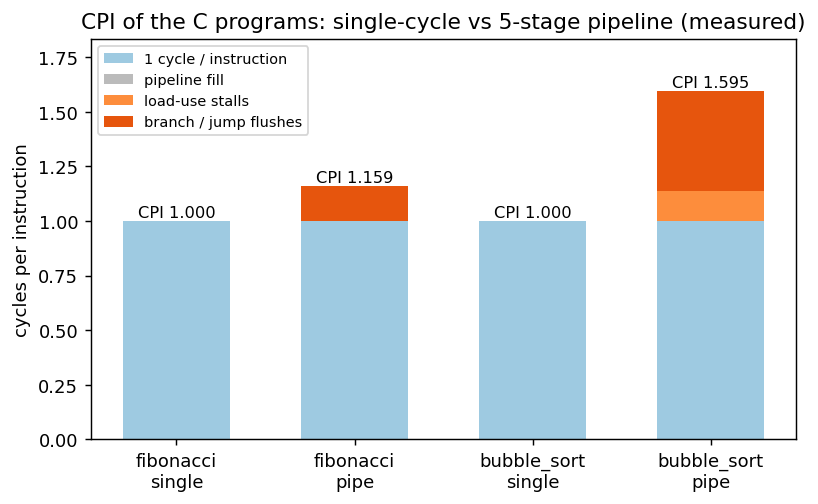
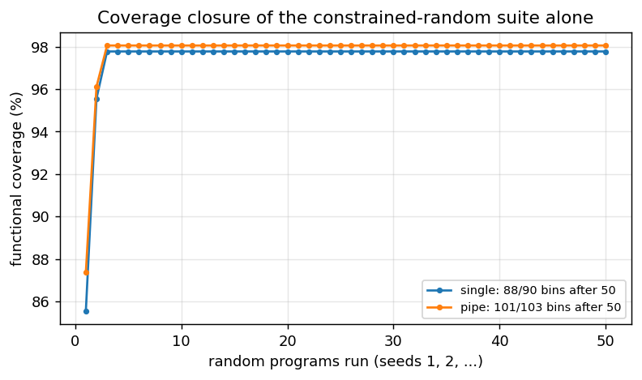

# rv32i-core-verif

[](https://github.com/ido55/rv32i-core-verif/actions/workflows/ci.yml)

Two RV32I CPUs in SystemVerilog: a single-cycle core and a **5-stage pipeline** with
forwarding, load-use stalls and branch flush. Both are verified **instruction by
instruction** against a Python golden model with cocotb + Verilator, using directed tests,
the official riscv-tests, constrained-random programs, functional coverage and mutation
analysis. Both are also synthesized with Yosys.

| At a glance (all measured, `make results`) | |
|---|---|
| Tests per core: directed + riscv-tests/C programs + random | **142 / 142 pass** on both cores, plus 436 model and block tests |
| Random-program sweep, one-off | **2,000 / 2,000** seeds pass on each core |
| Functional coverage | **103 / 103** bins (pipeline), **90 / 90** (single-cycle) |
| Injected pipeline bugs caught | **7 / 7**, by every suite type |
| CPI, pipeline (fibonacci / bubble sort) | **1.159 / 1.595** |
| Xilinx 7-series LUTs / flip-flops (pipeline) | **2,155 / 1,681** |

## Documentation

**[The guide](docs/guide/00_README.md)** teaches the whole project from first principles in 13 chapters:
- RISC-V and SystemVerilog basics;
- both cores, signal by signal, with cycle-by-cycle pipeline tables;
- the golden model and the verification methodology;
- every bug and every number, explained.

It finishes with interview questions and hands-on exercises. Each solution was verified by running it.

## Why this project

A CPU that runs a test program correctly is not the same as a verified CPU. Most pipeline
bugs (a missing forward, a stall one cycle short) only show up for particular instruction
sequences, and the wrong value may surface thousands of cycles after the instruction
that caused it. This project is built the way processor teams verify designs:

- an independent **golden model**, itself checked against the official tests;
- a **scoreboard** that compares every retired instruction, so a bug is reported at the
  exact instruction where core and model first disagree;
- **coverage**, to know what was tested;
- **mutation analysis**, to prove the tests can actually fail.

The single-cycle core came first. The pipeline was then verified with the same tests,
unchanged.

## Architecture



| Hazard | How `core_pipe.sv` handles it | Cost |
|---|---|---|
| ALU result needed 1 or 2 instructions later | forward from EX/MEM or MEM/WB into EX (EX/MEM wins: it is newer) | 0 cycles |
| Value written back while ID reads it | write-before-read bypass in ID | 0 cycles |
| Load result needed by the next instruction | stall IF/ID 1 cycle, bubble into EX, then forward from MEM/WB | 1 cycle |
| Taken branch, JAL, JALR | predict not taken; resolve in EX; flush IF and ID | 2 cycles |
| ECALL / EBREAK / illegal | flush younger instructions in EX and stop fetching | — |

Both cores share the decoder, ALU, branch unit, load/store unit and register file
(`rtl/`). They expose the same **retire port**, so every test runs on both.

## How the cores are checked

```mermaid
flowchart LR
    P[program words] --> IM[imem / dmem<br/>tb_top.sv] --> C[core_single.sv<br/>or core_pipe.sv]
    P --> ISS[Python ISS<br/>model/iss.py]
    C -- retire port, every instruction --> SB{scoreboard<br/>tb/harness.py}
    ISS -- Iss.step&#40;&#41; Retire record --> SB
    SB -- at halt --> F[compare all 31 registers<br/>and all of data memory]
```



The retire port is modelled on the RISC-V Formal Interface (RVFI). For every completed
instruction it reports:
- pc, instruction and next pc;
- the register written and its value;
- for loads and stores: address, byte masks and store data.

The testbench steps the ISS once per retired instruction and compares the two records.

The golden model is verified independently first:
- hand-computed tests per instruction;
- the encoder against GNU `as` on 1,600 random instructions;
- the official rv32ui riscv-tests.

### A failing test, as the scoreboard and the waveform show it

`make waveform` injects one bug from the mutation table below, removing the load-use
stall. It runs the directed test `hazard_load_use` with a VCD dump, restores the RTL, and
renders the failing cycles:



**How to read it:**
- **Orange cycle:** `add x3, x2, x0` is in EX while `lw x2` is still in MEM, so its data
  doesn't exist yet.
- **The bug:** `stall_load_use` stays at 0, so EX/MEM forwarding passes the load's
  *address* (0x2000) as x2.
- **Red cycle:** two cycles later, the scoreboard flags the first wrong instruction
  (`x3 = 0x2000`, model: `7`).

The fixed core inserts one bubble there.

## Results

All numbers below come from one command, run on a clean tree (406 s on the author's WSL2 laptop):

```bash
make results   # clean, synth, mutation, waveform, tests, test-report, coverage, cpi, plots
```

Each table also names the narrower command that prints it.

### Tests (`make test`, then `make test-report`)

| Suite | What it checks | single | pipe |
|---|---|---|---|
| `tests/model` (pytest) | ISS unit tests, encoder vs GNU `as`, **rv32ui riscv-tests on the ISS**, C programs and 200 random programs on the ISS, coverage collector | 429 / 429 (core-independent) | |
| `test_alu_rtl`, `test_regfile_rtl` | ALU (edge pairs + 1,000 random pairs per op), register file (2,000 random cycles) | 7 / 7 (shared blocks) | |
| `test_core_directed` | every RV32I instruction with edge cases, x0, halt, illegal trap, 5 hazard tests | 50 / 50 | 50 / 50 |
| `test_core_programs` | **official rv32ui riscv-tests** (40 of 42) + fibonacci + bubble sort | 42 / 42 | 42 / 42 |
| `test_core_random` | constrained-random programs, seeds 1-50 (~360 instructions each) | 50 / 50 | 50 / 50 |

**Excluded riscv-tests:** `fence_i` (self-modifying code) and `ma_data` (misaligned
access), both outside this design's scope.

**Larger sweeps:** one-off runs of 2,000 more seeds passed on both cores:
- single-cycle: 157 s;
- pipeline: 390 s;
- command: `make test-random CORE=<core> SEED_START=1000 SEEDS=2000`.

They aren't part of `make results`, because of their run time. See [docs/bugs.md](docs/bugs.md).

### Performance: CPI (`make cpi`, `make plots`)

| Program | Core | Instructions | Cycles | CPI | Load-use stall cycles | Flushes |
|---|---|---|---|---|---|---|
| fibonacci | single | 14,799 | 14,799 | 1.000 | - | - |
| fibonacci | pipe | 14,799 | 17,147 | 1.159 | 0 | 1,173 |
| bubble_sort | single | 3,639 | 3,639 | 1.000 | - | - |
| bubble_sort | pipe | 3,639 | 5,803 | 1.595 | 496 | 833 |



**Every pipeline cycle is accounted for**, and a test enforces it on every program:

`cycles = instructions + 4 (fill) + stall cycles + 2 × (flushes − 1)`

For bubble sort that is 3,639 + 4 + 496 + 2 × 832 = 5,803.

**Why the two programs differ:**
- Bubble sort's data-dependent branches are taken often, and each one costs 2 cycles with
  predict-not-taken.
- Its compare loads values right before using them, so it also hits load-use stalls.
- GCC's code for recursive fibonacci has no load-use pairs at all.

**What CPI doesn't show:** CPI counts clock cycles, and a pipeline's whole point is a shorter
clock period. That isn't measured here (see Limitations).

### Functional coverage (`make coverage`, `make plots`)

Coverage is sampled from every retired instruction, plus every clock cycle of the
pipeline's hazard logic:

| Coverpoint | Bins | single | pipe |
|---|---|---|---|
| opcode | 40 | 100% | 100% |
| branch taken / not taken | 12 | 100% | 100% |
| load / store width × byte offset | 20 | 100% | 100% |
| x0 as rd / rs1 / rs2 | 3 | 100% | 100% |
| immediate sign per format | 8 | 100% | 100% |
| read-after-write distance 1-3, load-use | 7 | 100% | 100% |
| pipeline: each forwarding path, newest-wins, bypass, stall, 4 flush causes | 13 | — | 100% |
| **total** | | **90 / 90** | **103 / 103** |



**What random tests leave out:** they reach 88 / 90 (single) and 101 / 103 (pipe). They never
produce EBREAK, because programs end with ECALL, or a backward JAL, because jumps only go
forward so every program terminates. The directed tests cover both.

**What the closure curve shows:** coverage stops rising after 3 random programs.
Meanwhile, the mutation table below has bugs that only 9 of 50 seeds catch. So 100%
coverage here means "every listed event happened", not "every bug is found". The coverage
model has no **cross** bins yet (for example, the forwarding path × which instruction
consumes the value). Those would keep rising where the bug-finding does.

### Can the tests find bugs? Mutation analysis (`make mutation`)

No RTL bug was found: the pipeline passed every suite on its first run. So this checks the
tests themselves. It injects 7 classic pipeline bugs, one at a time, and counts failing
tests (failing / run):

| Injected bug | Directed | Programs | Random |
|---|---|---|---|
| No EX/MEM forwarding (rs1) | 43 / 50 | 41 / 42 | 50 / 50 |
| No MEM/WB forwarding (rs2) | 6 / 50 | 11 / 42 | 50 / 50 |
| Forwarding priority wrong (MEM/WB beats EX/MEM) | 9 / 50 | 27 / 42 | 49 / 50 |
| Forwarding from x0 | 1 / 50 | 16 / 42 | 9 / 50 |
| No write-before-read bypass | 21 / 50 | 36 / 42 | 50 / 50 |
| No load-use stall | 2 / 50 | 7 / 42 | 35 / 50 |
| Flush squashes only IF, not ID | 50 / 50 | 42 / 42 | 50 / 50 |

**All 7 are caught by every suite.**

**A gap the first run found:** the directed tests missed "forwarding from x0" entirely
(0 / 45). I added the 5 hazard tests because of it.

The bugs that *were* found (in the verification setup) are logged in
[docs/bugs.md](docs/bugs.md).

### Synthesis (`make synth`)

Yosys 0.33. The memories sit outside the cores, so they aren't counted.

| Core | Generic cells | Flip-flops | 7-series LUTs | 7-series FFs | CARRY4 | MUXF7/8 |
|---|---|---|---|---|---|---|
| single | 6,438 | 1,057 | 1,946 | 1,037 | 50 | 254 |
| pipe | 7,502 | 1,681 | 2,155 | 1,681 | 58 | 511 |

**What the numbers mean:**
- **Flows:** "Generic" is technology-independent `synth -flatten`; "7-series" is
  `synth_xilinx -flatten`.
- **Register file:** 1,024 of the generic flip-flops in each core are the 32 × 32 register
  file (`$_SDFFCE_` cells).
- **The pipeline's cost:** 624 more flip-flops for the pipeline registers, +17% generic
  cells, +11% LUTs.
- **No warnings:** `make synth` fails on any Yosys warning or inferred latch. It runs in CI.

## Quick start

```bash
git clone --recursive https://github.com/ido55/rv32i-core-verif.git   # --recursive: riscv-tests submodule
cd rv32i-core-verif
```

With Docker (no local toolchain needed):

```bash
docker build -t rv32i-core-verif .
docker run --rm rv32i-core-verif                  # make lint test synth (CI runs exactly this)
```

Natively on Ubuntu 24.04 / WSL2:

```bash
sudo apt install build-essential python3-venv python3-dev verilator yosys gcc-riscv64-unknown-elf
bash tools/install_sv2v.sh       # pinned sv2v release into ~/.local/bin (only needed for synthesis)
make venv                        # .venv with pinned cocotb / pytest / ruff / matplotlib
make lint                        # ruff + verilator --lint-only -Wall, zero warnings
make test                        # golden-model tests + RTL tests on both cores (~2 min)
make test CORE=pipe              # one core only
make test-random CORE=pipe SEED_START=1000 SEEDS=500    # more random programs
make test-random CORE=pipe SEED_START=<seed> SEEDS=1 WAVES=1   # reproduce one seed, with a VCD
make results                     # regenerate everything in this README (~7 min)
make help                        # all targets
```

## Design decisions and tradeoffs

| Decision | Alternative rejected | Why |
|---|---|---|
| Own Python ISS as the golden model | Spike (the reference RISC-V simulator) | Every line is explainable and it's easy to get a per-instruction record from it. Risk: the same author writes core and model and could misread the spec the same way. Mitigated by checking the ISS against the official riscv-tests and the encoder against GNU `as` |
| Scoreboard on an RVFI-style retire port, every instruction | Comparing only final registers and memory | A bug is reported at the first wrong instruction, not when (or if) a wrong value reaches the end state. Same port on both cores, so one testbench |
| Branches resolved in EX, predict not taken | Resolve in ID (1-cycle penalty) | Redirect and flush logic sit in one place, with no forwarding paths into ID. Measured cost: 2 × 832 = 1,664 of bubble sort's 5,803 cycles are flush cycles |
| Forwarding + 1-cycle load-use stall | Stall on every dependency | The common ALU→ALU case costs 0 cycles. fibonacci has 0 stall cycles; bubble sort 496 |
| Register file with reset (all registers cleared) | No reset, so it can map to LUT RAM | Deterministic start state for comparing against the model. Cost: 1,024 flip-flops, since Xilinx LUT RAM has no reset |
| Combinational-read memories outside the core | Synchronous block RAM | Needed for the single-cycle core; keeps both cores memory-free for synthesis. Not FPGA-ready as is (see Limitations) |
| Own coverage collector (`tb/coverage.py`, 186 lines) | cocotb-coverage | ~100 bins don't need a framework; no extra dependency |
| Mutation analysis as a `make` target | Trusting coverage numbers | Random tests reach full coverage within 3 programs, yet one injected bug is caught by only 9 of 50 seeds (see above) |
| cocotb pinned to 1.9.2, sv2v for synthesis | cocotb 2.x; Yosys reading SV directly | Measured: cocotb 2.x refuses Verilator 5.020 (Ubuntu 24.04); Yosys 0.33 rejects package imports in module headers and `inside` |

## Limitations and next steps

**Limitations:**
- **ISA:** RV32I only, with no CSRs, interrupts or exceptions. Misaligned accesses and
  FENCE.I are out of scope, and ECALL/EBREAK just halt the core.
- **No timing analysis:** synthesis gives resource counts, not a clock frequency, so the
  pipeline's speed advantage over the single-cycle core isn't quantified.
- **Memories:** they read combinationally, which matches neither FPGA block RAM nor an SRAM
  macro.
- **Random generator:** branches only jump forward (guaranteed termination), so backward
  branches come only from the bounded loops and the C programs.
- **Coverage:** no cross bins, so the 100% coverage figure is coarse (see the closure plot).

**Next steps:**
- **Formal verification** with [riscv-formal](https://github.com/YosysHQ/riscv-formal):
  the retire port is already RVFI-shaped.
- **Synchronous memories plus FPGA place and route** (nextpnr, or Vivado) for a measured
  Fmax per core.
- **Cross coverage:** forwarding path × consumer instruction type, and stall × flush in
  neighbouring cycles.
- **A cheaper branch penalty:** a BTB/branch predictor or resolving branches in ID, measured
  with the same CPI breakdown.

## Repository layout

| Path | Contents |
|---|---|
| `rtl/` | `rv32i_pkg`, `alu`, `regfile`, `decoder`, `branch_unit`, `lsu`, `core_single`, `core_pipe` |
| `model/` | Python golden model: instruction table, encoder/decoder, reference ALU, ISS |
| `tb/` | `tb_top.sv` (core + 16 KiB memories), `harness.py` (scoreboard), random generator, coverage, program builds, reports |
| `tests/model/`, `tests/rtl/` | pytest for the golden model; cocotb testbenches launched from pytest |
| `programs/` | C programs (fibonacci, bubble sort), `crt0.S`, linker script, minimal riscv-tests environment |
| `tools/` | mutation analysis, synthesis report, waveform and plot rendering, sv2v installer |
| `third_party/riscv-tests` | official RISC-V ISA tests, git submodule pinned to `d7e86f7` |
| `docs/bugs.md` | bug log: real bugs, and the injected bugs used to prove the tests can fail |
| `docs/guide/` | the learning guide: 13 chapters, glossary, interview questions, exercises |
| `docs/img/` | images generated by `make results` |

## License

[MIT](LICENSE)
