# rv32i-core-verif

[](https://github.com/ido55/rv32i-core-verif/actions/workflows/ci.yml)

A 5-stage pipelined RV32I CPU in SystemVerilog, verified against a Python golden model
using cocotb + Verilator (directed tests, constrained-random streams, scoreboard,
functional coverage).

> **Status:** Milestone 3 of 5 (single-cycle core: riscv-tests, random tests, coverage). See [ROADMAP.md](ROADMAP.md).
> Results are added here only once measured, together with the command that produced them.

## Quick start

```bash
git clone --recursive https://github.com/ido55/rv32i-core-verif.git   # --recursive: riscv-tests submodule
cd rv32i-core-verif
```

With Docker (no local toolchain needed):

```bash
docker build -t rv32i-core-verif .
docker run --rm rv32i-core-verif          # runs: make lint test
```

Natively on Ubuntu 24.04 / WSL2:

```bash
sudo apt install build-essential python3-venv python3-dev verilator gcc-riscv64-unknown-elf
make venv        # .venv with pinned cocotb / pytest / ruff
make lint        # ruff + verilator --lint-only -Wall
make test        # golden-model tests + cocotb RTL tests
make test-rtl SEED=42 WAVES=1   # different random seed, dump waveforms to sim_build/
make test-random SEEDS=500      # more random programs (seeds 1..500)
make coverage                   # functional coverage of the last test run
```

## Layout

| Path | Contents |
|---|---|
| `model/` | Python golden model: instruction table, encoder/decoder, reference ALU, ISS |
| `rtl/` | SystemVerilog: `rv32i_pkg`, `alu`, `regfile`, `decoder`, `branch_unit`, `lsu`, `core_single` |
| `tb/` | `tb_top.sv` (core + 16 KiB memories), `harness.py` (scoreboard), `random_program.py` (generator), `coverage.py`, `programs.py` (GCC builds) |
| `programs/` | C programs (fibonacci, bubble sort), `crt0.S`, linker script, minimal riscv-tests environment |
| `third_party/riscv-tests` | official RISC-V ISA tests, git submodule pinned to `d7e86f7` |
| `tests/model/` | pytest for the golden model: unit tests, riscv-tests on the ISS, generator and coverage checks |
| `tests/rtl/` | cocotb testbenches, launched from pytest via the cocotb runner |
| `docs/bugs.md` | bug log (real bugs, and injected bugs used to prove the tests can fail) |

## How the core is checked

```mermaid
flowchart LR
    P[program words] --> IM[imem / dmem<br/>tb_top.sv] --> C[core_single.sv]
    P --> ISS[Python ISS<br/>model/iss.py]
    C -- retire port, every instruction --> SB{scoreboard<br/>tb/harness.py}
    ISS -- Iss.step&#40;&#41; Retire record --> SB
    SB -- at halt --> F[compare all 31 registers<br/>and all of data memory]
```



The core reports every instruction it completes on a **retire port** (pc, instruction,
next pc, register written, store address/data/byte mask), modelled on the RISC-V Formal
Interface. The testbench steps the ISS once per retired instruction and compares the two
records, so a bug is reported at the exact instruction where the core and model first
disagree, with the preceding instructions as context. For example, with LB deliberately
broken to zero-extend:

```
ScoreboardMismatch: retire #1 mismatch at pc=0x00000004: lb x10, 0(x1)
  rd_wdata   core=0x00000083  model=0xffffff83
```

## Current verification status (M3)

Measured with `make test` (all suites, single-cycle core):

| Suite | What it checks | Result |
|---|---|---|
| `tests/model` | ISS unit tests, encoder vs GNU `as`, **rv32ui riscv-tests on the ISS**, C programs on the ISS, 200 random programs on the ISS, coverage collector | 429 / 429 pass |
| `tests/rtl/test_alu.py`, `test_regfile.py` | ALU (edge pairs + 1,000 random pairs per op), register file (2,000 random cycles) | 7 / 7 pass |
| `tests/rtl/test_core_directed.py` | every RV32I instruction with edge cases, x0, halt, illegal-instruction trap | 45 / 45 pass |
| `tests/rtl/test_core_programs.py` | **official rv32ui riscv-tests** (40 of 42; `fence_i` and `ma_data` need features out of scope) + fibonacci + bubble sort, with the scoreboard on | 42 / 42 pass |
| `tests/rtl/test_core_random.py` | constrained-random programs, seeds 1-50 (~360 instructions each) | 50 / 50 pass |

A one-off sweep of 2,000 more seeds (`make test-random SEED_START=1000 SEEDS=2000`, 157 s)
also passed. No RTL bug has been found in the single-cycle core so far; see
[docs/bugs.md](docs/bugs.md), which also shows the injected bugs each suite caught.

### Functional coverage

Measured with `make test && make coverage` (90 bins, sampled from every retired instruction):

| Suite | Bins hit | Coverage |
|---|---|---|
| directed | 90 / 90 | 100.0% |
| programs (riscv-tests + C) | 89 / 90 | 98.9% |
| random (50 seeds) | 88 / 90 | 97.8% |
| **all suites** | **90 / 90** | **100.0%** |

Coverpoints: opcode (40), branch taken/not taken (12), load width × byte offset (13), store
width × byte offset (7), x0 as rd/rs1/rs2 (3), immediate sign per format (8), read-after-write
distance 1-3 for rs1/rs2 plus load-use (7). The random generator cannot hit `ebreak` (programs
end with ECALL) or a negative JAL offset (jumps only go forward, so programs always terminate);
the directed tests cover both.

## License

[MIT](LICENSE)
