# rv32i-core-verif

[](https://github.com/ido55/rv32i-core-verif/actions/workflows/ci.yml)

A 5-stage pipelined RV32I CPU in SystemVerilog, verified against a Python golden model
using cocotb + Verilator (directed tests, constrained-random streams, scoreboard,
functional coverage).

> **Status:** Milestone 2 of 5 (single-cycle core + scoreboard). See [ROADMAP.md](ROADMAP.md).
> Results are added here only once measured, together with the command that produced them.

## Quick start

With Docker (no local toolchain needed):

```bash
docker build -t rv32i-core-verif .
docker run --rm rv32i-core-verif          # runs: make lint test
```

Natively on Ubuntu 24.04 / WSL2:

```bash
sudo apt install build-essential python3-venv python3-dev verilator gcc-riscv64-unknown-elf
make venv        # .venv with pinned cocotb / pytest / ruff
make lint        # ruff + verilator --lint-only -Wall
make test        # golden-model tests + cocotb RTL tests
make test-rtl SEED=42 WAVES=1   # different random seed, dump waveforms to sim_build/
```

## Layout

| Path | Contents |
|---|---|
| `model/` | Python golden model: instruction table, encoder/decoder, reference ALU, ISS |
| `rtl/` | SystemVerilog: `rv32i_pkg`, `alu`, `regfile`, `decoder`, `branch_unit`, `lsu`, `core_single` |
| `tb/` | `tb_top.sv` (core + 16 KiB instruction and data memories) and `harness.py` (scoreboard) |
| `tests/model/` | pytest for the golden model, incl. an encoder cross-check against GNU `as` |
| `tests/rtl/` | cocotb testbenches, launched from pytest via the cocotb runner |

## How the core is checked

```mermaid
flowchart LR
    P[program words] --> IM[imem / dmem<br/>tb_top.sv] --> C[core_single.sv]
    P --> ISS[Python ISS<br/>model/iss.py]
    C -- retire port, every instruction --> SB{scoreboard<br/>tb/harness.py}
    ISS -- Iss.step&#40;&#41; Retire record --> SB
    SB -- at halt --> F[compare all 31 registers<br/>and all of data memory]
```



The core reports every instruction it completes on a **retire port** (pc, instruction,
next pc, register written, store address/data/byte mask), modelled on the RISC-V Formal
Interface. The testbench steps the ISS once per retired instruction and compares the two
records, so a bug is reported at the exact instruction where the core and model first
disagree, with the preceding instructions as context. For example, with LB deliberately
broken to zero-extend:

```
ScoreboardMismatch: retire #1 mismatch at pc=0x00000004: lb x10, 0(x1)
  rd_wdata   core=0x00000083  model=0xffffff83
```

## Current verification status (M2)

Measured with `make test`:

| Suite | What it checks | Result |
|---|---|---|
| `tests/model` | ISS (every RV32I instruction + edge cases), `li` helper, encoder/decoder round trips, 1,600 random instructions vs GNU `as` | 176 / 176 pass |
| `tests/rtl/test_alu.py` | all 10 ALU ops: 13×13 edge-value pairs + 1,000 random pairs per op, vs `model/alu.py` | 3 / 3 cocotb tests pass |
| `tests/rtl/test_regfile.py` | reset, x0 hard-wired, read-during-write, 2,000 cycles of random traffic | 4 / 4 cocotb tests pass |
| `tests/rtl/test_core_directed.py` | single-cycle core: every RV32I instruction (ALU edge operands, all branch outcomes, every load/store width and byte offset), x0, halt, illegal-instruction trap, 3 small programs | 45 / 45 cocotb tests pass |

## License

[MIT](LICENSE)
