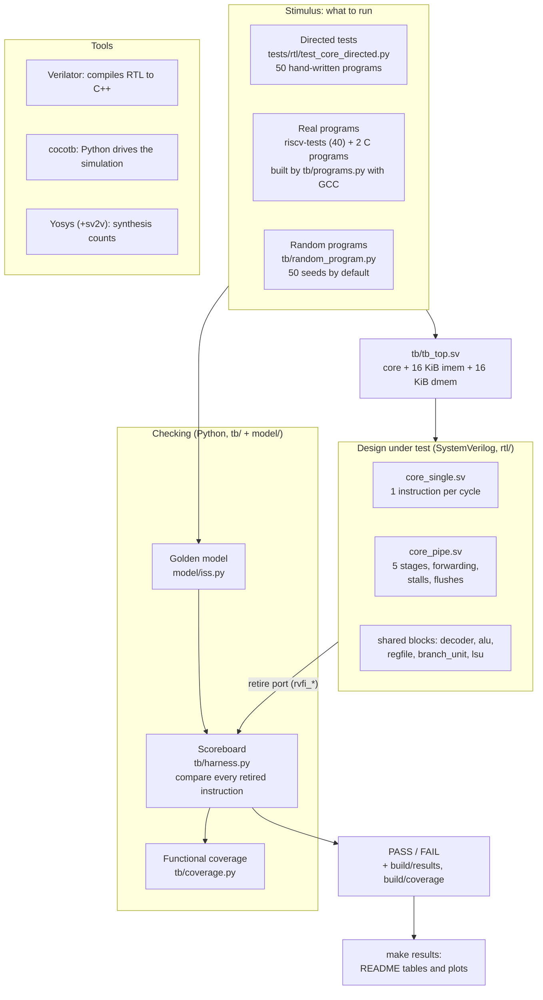

# The rv32i-core-verif guide

A from-the-ground-up course on this repository. The goal: after reading it, you can
explain any file, any signal and any number in this project in a verification or hardware
interview.

## What you'll learn

- The order to read the chapters in, and roughly how long each one takes.
- A one-page map of the whole project, to come back to whenever you get lost.

## Who this is for

You know Python, C and digital logic basics: gates, flip-flops, multiplexers (muxes),
finite-state machines (FSMs). You do **not** need to know SystemVerilog, RISC-V, CPU
pipelines, cocotb, Verilator, Yosys or verification methodology yet. Each of those is
explained from first principles, the first time it's needed.

## How to read it

- **Facts come from the code.** Every statement points at the code that implements it, as
  `path:line-range`, for example `rtl/core_pipe.sv:145-150`. Open the file next to the
  guide and check.
- **Examples first, then definitions.** Each idea starts with a concrete worked example
  and only then gets its general definition.
- **Numbers are measured.** Every number was produced by running the commands shown on
  this repository. None are estimates.
- **Problems are listed, not hidden.** Anything unclear, stale or questionable in the
  repo is collected under **Known gaps** at the end of the chapter where it comes up.
- **Self-test at the end.** Every chapter ends with "Check yourself": 3–5 questions,
  with the answers hidden in a click-to-open block.

## Reading order

| # | Chapter | What it covers | Time |
|---|---|---|---|
| 01 | [The big picture](01_big_picture.md) | What the project does and why; the full path from a test program to PASS/FAIL; a tour of every folder and important file | 25 min |
| 02 | [RISC-V basics](02_riscv_basics.md) | Registers, the 6 instruction formats with bit-field diagrams, hand-decoding one instruction of each format | 45 min |
| 03 | [SystemVerilog basics](03_systemverilog_basics.md) | Only the SystemVerilog this repo uses (modules, ports, `logic`, `always_ff` vs `always_comb`, parameters, packages, enums, structs), each with a snippet from `rtl/` | 45 min |
| 04 | [The single-cycle core](04_single_cycle_core.md) | Datapath and control, module by module; ADD, LW and BEQ traced signal by signal | 60 min |
| 05 | [The pipeline](05_pipeline.md) | Why pipeline; the 5 stages and pipeline registers; forwarding, load-use stall, branch flush; cycle-by-cycle tables for a program with hazards | 90 min |
| 06 | [The golden model](06_golden_model.md) | The Python instruction-set simulator: how it executes an instruction and stays in lockstep with the RTL | 30 min |
| 07 | [Verification](07_verification.md) | Concepts first (DUT, testbench, golden model, scoreboard, directed vs constrained-random, coverage), then this repo's version of each; one test followed from start to a reported mismatch | 75 min |
| 08 | [Bugs found](08_bugs_found.md) | Every entry in `docs/bugs.md`: what went wrong, why (in hardware terms), how it was caught, and the fix from `git log -p` | 30 min |
| 09 | [Tooling](09_tooling.md) | Verilator, cocotb, pytest, Yosys + sv2v, GTKWave, Docker, Make, GitHub Actions: what each is, why it's here, exact commands, and what happens step by step when you run `make test` | 45 min |
| 10 | [Results](10_results.md) | Every number in the README: what it measures, how it was produced, how to reproduce it, and what it means (and doesn't mean) | 30 min |
| 11 | [Code reference](11_code_reference.md) | File by file: purpose, key modules and functions, inputs and outputs, who uses it | reference |
| 12 | [Interview prep](12_interview_prep.md) | 25+ questions from easy to hard with short answers, including "hardest bug" and "what would you improve" | 45 min |
| 13 | [Exercises](13_exercises.md) | 8–10 hands-on exercises of increasing difficulty (add an instruction, break forwarding, add a coverpoint, read a waveform), with hints and solutions | 4–6 h |
| — | [Glossary](glossary.md) | Every term and acronym, one or two lines each | reference |

**Total:** about 9 hours of reading, plus the exercises.

**If you only have 2 hours before an interview:** read 01, 05, 07 and 12.

**Prerequisites:** chapters 02 and 03 are the foundation for 04 and 05. Chapter 06 is
needed before 07.

## The project on one page

**Five ideas hold the whole project together:**

1. **Two cores, one interface.** `core_single.sv` and `core_pipe.sv` have identical ports,
   including a **retire port** that reports every completed instruction. Everything that
   tests one core tests the other unchanged.
2. **An independent reference.** `model/iss.py` is a Python program that executes RISC-V
   instructions the way the specification says. It is checked on its own first, against
   hand-computed values, GNU `as` and the official riscv-tests.
3. **Lockstep comparison.** For every instruction the core retires, the testbench runs
   one step of the model and compares the two records field by field. The first
   difference stops the test, with a readable report.
4. **Three kinds of stimulus:** hand-written directed tests, official and compiled
   programs, and seeded random programs. Functional coverage measures what they exercised.
5. **Proof that the tests can fail.** Mutation analysis injects 7 realistic pipeline bugs
   and counts how many tests catch each one.

## Measured facts used throughout the guide

All of these were produced by `make results` on this repository. Chapter 10 explains each
one and how to reproduce it.

| What | single-cycle | pipeline |
|---|---|---|
| Directed / program / random tests passing | 50/50, 42/42, 50/50 | 50/50, 42/42, 50/50 |
| Functional coverage | 90/90 bins | 103/103 bins |
| CPI, fibonacci / bubble sort | 1.000 / 1.000 | 1.159 / 1.595 |
| Yosys generic cells / flip-flops | 6,438 / 1,057 | 7,502 / 1,681 |
| Injected pipeline bugs caught | — | 7 of 7 |

## Known gaps found while writing this guide

Every chapter ends with its own Known gaps. These are the most important ones, worth
knowing before an interview:

| Gap | Where |
|---|---|
| Synthesis counts are pre-place-and-route: LUTs and the 1,071 / 1,328 `INV` cells are reported separately, and the 208-bit retire port is included | [10](10_results.md) |
| The coverage model has no cross bins, so random coverage saturates after 3 seeds while bug detection keeps improving | [07](07_verification.md) |
| No timing analysis, so the pipeline's speed advantage is not measured | [10](10_results.md) |
| The two real bugs have no before/after commits: both were fixed before being committed | [08](08_bugs_found.md) |
| The pipeline stalls on load → store-data even though the data isn't needed until MEM | [05](05_pipeline.md) |
| A few stale comments and docs: the `test_core_directed.py` docstring, `CLAUDE.md` waveform path and `docker-test` command, `make help`'s run time | [01](01_big_picture.md), [07](07_verification.md), [09](09_tooling.md) |

## Check yourself

1. Which two chapters should you read before the pipeline chapter, and why?
2. What is the single interface that lets the same tests run on both cores?
3. Name the three kinds of stimulus the project uses.

Answers

1. Chapters 02 (RISC-V basics) and 03 (SystemVerilog basics). The pipeline chapter reads
   instruction fields and SystemVerilog structs everywhere. Chapter 04 also helps, since
   the pipeline reuses the single-cycle core's blocks.
2. The retire port (`rvfi_*` outputs, defined in `rtl/core_single.sv:25-37` and
   `rtl/core_pipe.sv:31-42`), which mirrors the Python `Retire` record in
   `model/iss.py:53-74`.
3. Directed tests, real programs (riscv-tests and C programs), and constrained-random
   programs.

