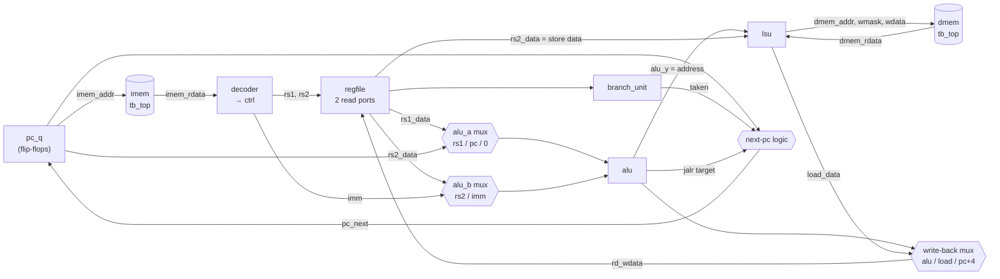

# 04 · The single-cycle core

## What you'll learn

- What "datapath" and "control" mean, and how they split the work of a CPU.
- Each building block (decoder, register file, ALU, branch unit, load/store unit), what
  it computes, and where in `rtl/` it does it.
- How `rtl/core_single.sv` wires them into a CPU that finishes one instruction per clock
  cycle.
- Three instructions traced signal by signal, with real values: an ADD, a LW and a BEQ.
- What the retire port reports, and when.

---

## 1. A worked example first

Here is the start of the directed test `hazard_load_use`
(`tests/rtl/test_core_directed.py:336-359`), as executed by the golden model. These are
real encodings and values:

| pc | Machine word | Instruction | Effect |
|---|---|---|---|
| 0x00 | `0x000020b7` | `lui x1, 0x2` | x1 = 0x2000 |
| 0x04 | `0x0000a103` | `lw x2, 0(x1)` | x2 = mem[0x2000] = 7 |
| 0x08 | `0x000101b3` | `add x3, x2, x0` | x3 = 7 + 0 = 7 |
| … | | | |
| 0x28 | `0x00548463` | `beq x9, x5, .+8` | x9 = x5 = 9, so jump to 0x30 |

Data memory starts with `mem[0x2000] = 7` and `mem[0x2004] = 9`
(`tests/rtl/test_core_directed.py:356`).

On the single-cycle core, each of those rows takes exactly **one clock cycle**:

- **During the cycle,** combinational logic computes everything:
  - fetch the instruction at `pc_q`;
  - decode it;
  - read registers;
  - compute;
  - read memory;
  - choose the value to write back;
  - compute the next pc.
- **At the rising edge,** three things change state together: `pc_q`, the destination
  register, and (for stores) data memory.

By the end of this chapter you will be able to follow every signal of rows 0x04, 0x08 and
0x28.

## 2. Datapath and control

A CPU is usually described in two halves:

- **The datapath** is the hardware that moves and transforms data: the register file, the
  ALU, the muxes that choose operands, the memory interface, the next-pc adder.
- **Control** is the logic that tells the datapath what to do for *this* instruction:
  which mux inputs to select, whether to write a register, whether to write memory.

Here, control is one module, `rtl/decoder.sv`. It turns the 32-bit instruction into one
struct of control signals, `ctrl_t` (`rtl/rv32i_pkg.sv:66-86`). Everything else is datapath.



The memories are **outside** the core, in `tb/tb_top.sv:36-38`. Both are read
**combinationally**: change the address and the data appears in the same cycle
(`tb/tb_top.sv:62-63`). That is what lets one cycle do everything. Chapter 05 shows why it
doesn't scale, and Limitations in the README note that real block RAMs don't work this way.

## 3. The building blocks

### 3.1 Decoder: `rtl/decoder.sv`

**Input:** the 32-bit `insn`. **Output:** `ctrl` of type `ctrl_t`. It is purely
combinational, so both cores can use it (`rtl/decoder.sv:1-2`).

How it works:

1. **Split the fields** (`rtl/decoder.sv:14-16`) and **build all five immediates**
   (`rtl/decoder.sv:21-25`), whichever one turns out to be needed (chapter 02).
2. **Set defaults that do nothing** (`rtl/decoder.sv:33-40`): no register write, no
   memory access, ALU does ADD of rs1 and rs2, write back the ALU result.
3. **Switch on the opcode** and turn on only what the instruction needs
   (`rtl/decoder.sv:42-127`).
4. **Work out `uses_rs1` and `uses_rs2`** (`rtl/decoder.sv:131-132`). These say which source
   registers are really read. They matter only for the pipeline (chapter 05).
5. **If the instruction is illegal, clear every state-changing flag**
   (`rtl/decoder.sv:135-144`), so it can't write anything.

What each opcode turns on:

| Opcode | reg_write | alu_a_sel | alu_b_imm | imm | wb_sel | Other |
|---|---|---|---|---|---|---|
| LUI | 1 | ZERO | 1 | U | ALU | ALU computes 0 + imm |
| AUIPC | 1 | PC | 1 | U | ALU | ALU computes pc + imm |
| JAL | 1 | (RS1) | 0 | J | PC4 | `is_jal` |
| JALR | 1 | RS1 | 1 | I | PC4 | `is_jalr`; ALU computes rs1 + imm = target; illegal if funct3 ≠ 0 |
| BRANCH | 0 | RS1 | 0 | B | — | `is_branch`; illegal if funct3 is 010/011 |
| LOAD | 1 | RS1 | 1 | I | MEM | `mem_read`; ALU computes the address |
| STORE | 0 | RS1 | 1 | S | — | `mem_write` |
| OP-IMM | 1 | RS1 | 1 | I | ALU | `alu_op` from funct3, plus funct7[5] for SRAI |
| OP | 1 | RS1 | 0 | — | ALU | `alu_op = {funct7[5], funct3}` |
| MISC-MEM | 0 | | | | | FENCE does nothing; illegal unless funct3 = 0 |
| SYSTEM | 0 | | | | | `halt` for ECALL/EBREAK, otherwise illegal |

Anything else is illegal (`rtl/decoder.sv:126`).

**How the ALU operation is picked.** The `alu_op` values were chosen as
`{funct7[5], funct3}` (`rtl/rv32i_pkg.sv:36-49`). For OP instructions that makes the
decoder line a single cast:

```systemverilog
ctrl.alu_op    = alu_op_e'({funct7[5], funct3});      // rtl/decoder.sv:112
```

For `add`, funct7[5] = 0 and funct3 = 000, which gives `4'b0000` = `ALU_ADD`. For `sub`,
funct7[5] = 1, which gives `4'b1000` = `ALU_SUB`.

### 3.2 Register file: `rtl/regfile.sv`

Chapter 03 walked through it:
- two combinational read ports;
- one write port, written at the rising edge;
- x0 hard-wired to 0;
- synchronous reset clears all 32 registers (`rtl/regfile.sv:20-29`).

**Reading and writing the same register in the same cycle returns the *old* value.**
There is no internal bypass (`rtl/regfile.sv:2-3`). For the single-cycle core that's
correct: the instruction reads its sources before its own result is written. The unit
test `read_during_write_returns_old_value` checks it (`tests/rtl/test_regfile.py:64-75`).

### 3.3 ALU: `rtl/alu.sv`

The ALU takes `op`, `a` and `b` and produces `y`, one of ten operations
(`rtl/alu.sv:15-29`). Shifts use `b[4:0]` (`rtl/alu.sv:12-13`). Unused operation codes
output 0, and a unit test checks that (`tests/rtl/test_alu.py:49-59`).

### 3.4 Branch unit: `rtl/branch_unit.sv`

The branch unit compares rs1 and rs2 according to funct3 and outputs `taken`
(`rtl/branch_unit.sv:11-21`). It is separate from the ALU, so a branch doesn't need the
ALU to compare. That's why the ALU result for a branch is simply unused.

### 3.5 Load/store unit (LSU): `rtl/lsu.sv`

Data memory is organised as 32-bit **words** with 4 **byte enables**, a 4-bit
`dmem_wmask` that says which of the word's 4 bytes to write (`tb/tb_top.sv:65-69`). The
LSU translates byte and halfword accesses into that form. It does three jobs:

| Job | Code | Example: `sb` of 0xAABBCCDD to address 0x2005 |
|---|---|---|
| **Byte mask:** which lanes are accessed | `rtl/lsu.sv:23-30` | offset 1 → `4'b0001 << 1` = `0010` |
| **Store data:** move the value into its lane | `rtl/lsu.sv:32-38` | `{24'b0, 0xDD} << 8` = `0x0000DD00` |
| **Load data:** pull out and extend the addressed part | `rtl/lsu.sv:20-21,40-48` | `lb` at offset 3 of 0x80818283: shift right 24 → 0x80 → sign-extend → 0xFFFFFF80 |

The directed tests `load_*` and `store_*` check every width at every legal offset
(`tests/rtl/test_core_directed.py:152-193`).

## 4. Wiring it together: `rtl/core_single.sv`

The file follows the order of the datapath diagram:

| Section | Lines | What happens |
|---|---|---|
| Ports | `7-38` | memory interfaces, `halted`, and the retire port `rvfi_*` |
| `active` | `52` | the core executes only when out of reset and not halted |
| Fetch and decode | `59-77` | `imem_addr = pc_q`; decoder; register file (write enable = `active && ctrl.reg_write`) |
| Execute | `79-102` | ALU operand muxes, ALU, branch unit |
| Next pc | `104-114` | halt → stay; JAL → pc + imm; JALR → (rs1 + imm) with bit 0 cleared; taken branch → pc + imm; else pc + 4 |
| Memory | `116-128` | LSU; `dmem_addr` is the ALU result with the low 2 bits cleared; write mask only when `active && mem_write` |
| Write back | `130-137` | `rd_wdata` = load data, pc + 4, or the ALU result |
| State | `139-148` | at each rising edge: `pc_q <= pc_next`; set `halted_q` on ECALL/EBREAK/illegal |
| Retire port | `152-167` | describes the instruction executing *this* cycle |

There are only **two state elements of its own**, `pc_q` and `halted_q`
(`rtl/core_single.sv:40-41`). The register file and the memories hold the rest.

## 5. Trace 1: `lw x2, 0(x1)` at pc 0x04

**Before the cycle:** x1 = 0x2000 (from the `lui` at pc 0), and `mem[0x2000] = 7`.

| Signal | Value | Why (code) |
|---|---|---|
| `imem_addr` | 0x04 | `= pc_q` (`core_single.sv:60`) |
| `imem_rdata` | 0x0000a103 | tb_top reads imem[1] (`tb_top.sv:62`) |
| `ctrl.rd / rs1` | 2 / 1 | `insn[11:7]`, `insn[19:15]` (`decoder.sv:34-35`) |
| `ctrl.imm` | 0 | I-type immediate (`decoder.sv:84`) |
| `ctrl.mem_read, reg_write` | 1, 1 | LOAD case (`decoder.sv:79-86`) |
| `ctrl.wb_sel` | WB_MEM | `decoder.sv:81` |
| `ctrl.alu_op` | ALU_ADD | the default (`decoder.sv:38`) |
| `ctrl.funct3` | 010 (W) | `decoder.sv:37` |
| `rs1_data` | 0x2000 | regfile read of x1 |
| `alu_a`, `alu_b` | 0x2000, 0 | rs1, and imm because `alu_b_imm = 1` (`core_single.sv:80-88`) |
| `alu_y` | 0x2000 | the address |
| `dmem_addr` | 0x2000 | `{alu_y[31:2], 2'b00}` (`core_single.sv:127`) |
| `dmem_rdata` | 7 | tb_top reads dmem[0x2000 >> 2] (`tb_top.sv:60,63`) |
| `byte_mask` | 1111 | W (`lsu.sv:27`) |
| `load_data` | 7 | LW passes the word through (`lsu.sv:46`) |
| `dmem_wmask` | 0000 | not a store (`core_single.sv:128`) |
| `rd_wdata` | 7 | `wb_sel = WB_MEM` (`core_single.sv:133`) |
| `pc_next` | 0x08 | pc + 4 (`core_single.sv:113`) |
| **rising edge** | x2 ← 7, pc_q ← 0x08 | `regfile.sv:24`, `core_single.sv:145` |

**Retire port during this cycle** (`core_single.sv:156-167`):
- valid = 1, pc = 0x04, insn = 0x0000a103, next_pc = 0x08;
- rd = 2, rd_wdata = 7;
- mem_addr = 0x2000, mem_rmask = 1111;
- mem_wmask = 0, mem_wdata = 0.

That's exactly the record the golden model produced:
`pc=0x04 ... rd=x2=0x7 mem=0x2000 rmask=1111`.

## 6. Trace 2: `add x3, x2, x0` at pc 0x08

**Before the cycle:** x2 = 7. It was written at the end of the previous cycle, so the
register file now returns it. No forwarding is needed in a single-cycle core.

| Signal | Value | Why (code) |
|---|---|---|
| `imem_rdata` | 0x000101b3 | |
| `ctrl.rd / rs1 / rs2` | 3 / 2 / 0 | |
| `ctrl.alu_op` | ALU_ADD | `{funct7[5]=0, funct3=000}` (`decoder.sv:112`) |
| `ctrl.alu_b_imm` | 0 | OP uses rs2 |
| `ctrl.reg_write`, `wb_sel` | 1, WB_ALU | |
| `rs1_data`, `rs2_data` | 7, 0 | rs2 = x0 always reads 0 (`regfile.sv:29`) |
| `alu_y` | 7 | 7 + 0 |
| `branch_taken` | 0 | the branch unit runs anyway (funct3 000 = "equal": 7 == 0 is false), but `is_branch = 0`, so it's ignored |
| `byte_mask` | 1000 | the LSU also runs anyway: funct3 000 = byte, offset `alu_y[1:0]` = 3. It's ignored because `mem_write = 0` and `mem_read = 0` |
| `dmem_wmask` | 0000 | |
| `rd_wdata` | 7 | |
| `pc_next` | 0x0c | |
| **rising edge** | x3 ← 7, pc_q ← 0x0c | |

**Retire record:** pc = 0x08, next_pc = 0x0c, rd = 3, rd_wdata = 7, and all memory
fields 0. `rvfi_mem_rmask` is 0 even though `byte_mask` is 1000, because it is gated by
`mem_read` (`core_single.sv:163`).

**The lesson:** in hardware, every block computes something every cycle. Control decides
which results *matter*. The gating on the retire port and on `dmem_wmask` is what keeps
the irrelevant values from leaking out.

## 7. Trace 3: `beq x9, x5, .+8` at pc 0x28

**Before the cycle:** x9 = 9 and x5 = 9.

| Signal | Value | Why (code) |
|---|---|---|
| `imem_rdata` | 0x00548463 | |
| `ctrl.rs1 / rs2` | 9 / 5 | |
| `ctrl.is_branch` | 1 | `decoder.sv:74` |
| `ctrl.imm` | 8 | B-type immediate (`decoder.sv:23,75`) |
| `ctrl.reg_write` | 0 | branches write no register |
| `ctrl.funct3` | 000 (BEQ) | |
| `rs1_data`, `rs2_data` | 9, 9 | |
| `branch_taken` | 1 | `F3_BEQ: taken = (a == b)` (`branch_unit.sv:13`) |
| `alu_y` | 18 | ALU_ADD of 9 + 9; computed but unused |
| `pc_target` | 0x30 | `pc_q + ctrl.imm` = 0x28 + 8 (`core_single.sv:106`) |
| `pc_next` | 0x30 | `is_branch && branch_taken` (`core_single.sv:112`) |
| `dmem_wmask` | 0000 | |
| **rising edge** | pc_q ← 0x30; no register written | |

**Retire record:** pc = 0x28, next_pc = **0x30**, rd = 0. The instruction at 0x2c
(`addi x10, x0, 1`) never executes, which is why the test expects x10 = 0
(`tests/rtl/test_core_directed.py:357`).

**Why `next_pc` is on the retire port:** it is how the scoreboard checks branch decisions.
A BEQ that wrongly falls through retires with `next_pc = 0x2c` instead of `0x30`, and the
mismatch is reported right there. (Chapter 08 shows a real injected example:
`bge x19, x19`.)

## 8. Halting and illegal instructions

**ECALL or EBREAK:**
- `ctrl.halt` is set;
- `pc_next` stays at `pc_q` (`core_single.sv:109`);
- at the edge, `halted_q` becomes 1 (`core_single.sv:146`);
- from then on `active = 0`, so the core writes nothing and retires nothing
  (`core_single.sv:52,156`).

The halting instruction itself retires with `rvfi_halt = 1`.

**An illegal word** (for example 0xFFFFFFFF) does the same, but sets `rvfi_trap`. The
decoder has already cleared its write flags (`decoder.sv:135-144`). The harness stops
there, and expects a trap only in the test that asks for one (`tb/harness.py:173-177`).

## 9. Timing: why "single-cycle" has a cost

**CPI is exactly 1.000.** Every instruction takes one cycle, and the test suite asserts
`cycles == instructions` for every program on this core
(`tests/rtl/test_core_programs.py:43-45`).

**The cost is the clock period.** The clock must be slow enough for the *longest* path:

```
pc → imem read → decode → regfile read → ALU (address add) → dmem read → LSU → write-back mux → regfile input
```

All of it in one cycle. Chapter 05 cuts that path into five shorter pieces.

This project does not measure clock frequency. Chapter 10 explains why the synthesis
numbers are counts, not speeds.

## Known gaps

- **The branch target adder** `pc_target = pc_q + ctrl.imm` (`core_single.sv:106`) is a
  second adder next to the ALU. That's normal, but it means the "ALU result for a branch is
  unused" design spends area on clarity. It isn't measured separately.
- **Loads and stores the memory can't serve.** `lsu.sv` doesn't handle misaligned
  addresses (it assumes legal offsets, `rtl/lsu.sv:4`), and `tb_top` ignores address bits
  above the 16 KiB range. Neither core detects these cases. Only the testbench's
  `mem_fault` check does (`tb/tb_top.sv:79-82`), so a real system would need a trap.

## Check yourself

1. Which module is "control", and what does it output?
2. In trace 2, the LSU computes `byte_mask = 1000`. Why doesn't that write memory, and why doesn't it show up on the retire port?
3. Where is a branch's taken/not-taken decision visible to the scoreboard?
4. Why can the single-cycle core read x2 in the cycle right after the `lw` that wrote it, without forwarding?
5. List the three things that change state at the rising edge of a store instruction's cycle.

<details>
<summary>Answers</summary>

1. `rtl/decoder.sv`. It outputs one `ctrl_t` struct (`rtl/rv32i_pkg.sv:66-86`).
2. `dmem_wmask` is gated by `ctrl.mem_write` (`core_single.sv:128`), and `rvfi_mem_rmask`
   by `ctrl.mem_read` (`core_single.sv:163`). Both are 0 for ADD.
3. In `rvfi_next_pc`: a taken branch retires with pc + imm, a not-taken one with pc + 4
   (`core_single.sv:159`).
4. The `lw` wrote x2 at the rising edge that ended its own cycle. The `add` reads in the
   next cycle, after that edge, so the register file already holds 7.
5. `pc_q`, `halted_q` (unchanged unless halting) and the data memory bytes selected by
   `dmem_wmask`. A store doesn't write a register: `reg_write = 0`.

</details>
