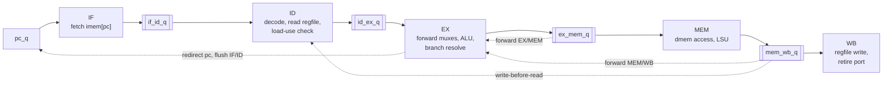

# 05 · The 5-stage pipeline

## What you'll learn

- Why CPUs are pipelined, and what that buys (and costs).
- The five stages IF, ID, EX, MEM, WB, the four pipeline registers between them, and what a
  **bubble** is.
- The three hazards this core handles, and exactly which lines of `rtl/core_pipe.sv`
  handle each:
  - **forwarding** (and the write-before-read bypass);
  - the **load-use stall**;
  - the **branch/jump flush**.
- How to read a cycle-by-cycle pipeline table. Three real ones are included, extracted from
  waveforms of the actual core.
- Why the measured CPI is 1.159 and 1.595, and the formula that accounts for every cycle.

---

## 1. A worked example first: six instructions, no stalls

This is a real run of the directed test `hazard_forwarding_distances`
(`tests/rtl/test_core_directed.py:308-321`) on `core_pipe`. Each row is one clock cycle,
sampled at the falling edge, the same moment the testbench samples. Each column shows
which instruction sits in which stage. `·` is an empty slot, a **bubble**.

| Cycle | IF (pc) | ID | EX | MEM | WB | fwd a / b | retires |
|---|---|---|---|---|---|---|---|
| 1 | 0x00 | · | · | · | · | - / - | |
| 2 | 0x04 | `addi x1, x0, 10` | · | · | · | - / - | |
| 3 | 0x08 | `addi x2, x1, 1` | `addi x1, x0, 10` | · | · | - / - | |
| 4 | 0x0c | `addi x3, x1, 2` | `addi x2, x1, 1` | `addi x1, x0, 10` | · | **EX/MEM** / - | |
| 5 | 0x10 | `addi x4, x1, 3` | `addi x3, x1, 2` | `addi x2, x1, 1` | `addi x1, x0, 10` | **MEM/WB** / - | pc 0x00, x1=0xa |
| 6 | 0x14 | `add x5, x3, x2` | `addi x4, x1, 3` | `addi x3, x1, 2` | `addi x2, x1, 1` | - / - | pc 0x04, x2=0xb |
| 7 | 0x18 | `sub x6, x4, x5` | `add x5, x3, x2` | `addi x4, x1, 3` | `addi x3, x1, 2` | **MEM/WB** / - | pc 0x08, x3=0xc |
| 8 | 0x1c | `ecall` | `sub x6, x4, x5` | `add x5, x3, x2` | `addi x4, x1, 3` | **MEM/WB** / **EX/MEM** | pc 0x0c, x4=0xd |
| 9 | 0x20 | `0x00000000` | `ecall` | `sub x6, x4, x5` | `add x5, x3, x2` | - / - | pc 0x10, x5=0x17 |
| 10 | 0x20 | · | · | `ecall` | `sub x6, x4, x5` | - / - | pc 0x14, x6=0xfffffff6 |
| 11 | 0x20 | · | · | · | `ecall` | - / - | pc 0x18 |

Read the table diagonally. `addi x1, x0, 10` enters ID in cycle 2, EX in 3, MEM in 4 and
WB in 5, where it retires. A new instruction enters every cycle, so from cycle 5 on, one
instruction finishes every cycle even though each one takes 5 cycles.

Three cycles show the forwarding paths:

- **Cycle 4.** `addi x2, x1, 1` is in EX and needs x1. x1 hasn't been written to the
  register file yet: its producer is in MEM. The core takes the value straight from the
  EX/MEM pipeline register. That's **forwarding**.
- **Cycle 5.** `addi x3, x1, 2` needs x1, and the producer is now one stage further, in WB.
  The value comes from MEM/WB.
- **Cycle 6.** `addi x4, x1, 3` reads x1 in ID during cycle 5, while the producer is
  being written back in that same cycle. The **write-before-read bypass** handles it
  inside ID, which is why EX shows no forwarding in cycle 6.

The rest of the chapter explains each of those mechanisms with the code.

## 2. Why pipeline?

The single-cycle core does all the work of one instruction in one cycle (chapter 04). So
the clock period must cover the longest chain:

```
fetch → decode → register read → ALU → data memory → write-back mux
```

**The idea of pipelining** is to cut that chain into 5 pieces with flip-flops in between.
Each piece is about a fifth as long, so the clock can be roughly up to 5× faster. Every
instruction still passes through all the logic, now spread over 5 cycles. In return,
5 different instructions are being worked on at once.

- **Latency** (time for one instruction): about the same, or slightly worse.
- **Throughput** (instructions finished per second): up to about 5× better.

**The catch:** instructions in flight depend on each other. When a later instruction
needs a result that isn't ready, the pipeline must:
- get the value early (**forward**),
- wait (**stall**), or
- throw away work it started on the wrong assumption (**flush**).

Those situations are called **hazards**. They are why CPI rises above 1 (section 9).

This repo measures CPI, not clock speed (chapter 10). So it shows the *cost* of
pipelining, but not the *benefit*. Keep that in mind in interviews.

## 3. The five stages and the pipeline registers



| Stage | Does | Code |
|---|---|---|
| **IF**: instruction fetch | `imem_addr = pc_q`; the word read is captured into `if_id_q` at the edge | `core_pipe.sv:112-113`, `302-311` |
| **ID**: instruction decode | decoder; register file read; write-before-read bypass; load-use detection | `core_pipe.sv:115-159` |
| **EX**: execute | choose forwarded operands; ALU; branch unit; decide redirect, flush or halt | `core_pipe.sv:161-251` |
| **MEM**: memory | data-memory address, store mask/data, load extraction via the LSU | `core_pipe.sv:253-287` |
| **WB**: write back | register-file write (`wb_we`, `rd_data`); the retire port | `core_pipe.sv:126-138`, `327-342` |

### Pipeline registers

A **pipeline register** is a bank of flip-flops between two stages. It holds everything
the later stages need to know about the instruction passing through. Here each one is a
packed struct (chapter 03), declared in `rtl/core_pipe.sv:48-93`:

| Register | Between | Carries |
|---|---|---|
| `if_id_q` | IF → ID | valid, pc, insn |
| `id_ex_q` | ID → EX | valid, pc, insn, the whole `ctrl_t`, rs1/rs2 values read in ID |
| `ex_mem_q` | EX → MEM | valid, pc, insn, next_pc, rd, reg_write, mem_read/write, funct3, `result` (ALU result, pc+4, or the load/store address), forwarded `store_data`, halt, illegal |
| `mem_wb_q` | MEM → WB | valid, pc, insn, next_pc, rd, reg_write, `wb_data` (the value for rd), the memory fields for the retire port, halt, illegal |

**Why carry `pc` and `insn` all the way to WB?** The retire port reports them when the
instruction finishes (`core_pipe.sv:331-333`). Without them the pipeline could not tell the
scoreboard which instruction just completed.

### Bubbles: the `valid` bit

Every pipeline register starts with `valid`. **`valid = 0` means the slot holds no
instruction**, a bubble (`core_pipe.sv:45-46`). A bubble:
- doesn't write registers: `wb_we` needs `mem_wb_q.valid` (`core_pipe.sv:126`);
- doesn't write memory: `dmem_wmask` needs `ex_mem_q.valid` (`core_pipe.sv:270`);
- doesn't forward: `exmem_writes`/`memwb_writes` need valid (`core_pipe.sv:172-173`);
- doesn't retire: `rvfi_valid = mem_wb_q.valid` (`core_pipe.sv:331`).

There are two ways to make a bubble:
- assign `'0` to the whole register (stall or flush, `core_pipe.sv:305,307,314`);
- reset (`core_pipe.sv:293-300`).

### How everything moves: one `always_ff` block

All the pipeline registers update together at each rising edge (`core_pipe.sv:292-323`).
The default is that every instruction moves one stage forward. The exceptions are the
hazard mechanisms below. Here's the core of it:

```systemverilog
      // PC and IF/ID
      if (ex_redirect) begin
        pc_q    <= ex_redirect_pc;
        if_id_q <= '0;
      end else if (ex_halt || fetch_stopped_q) begin
        if_id_q <= '0;                       // fetch nothing more
      end else if (!stall_load_use) begin
        pc_q    <= pc_q + 32'd4;
        if_id_q <= '{valid: 1'b1, pc: pc_q, insn: imem_rdata};
      end                                    // stall: keep pc_q and if_id_q

      // ID/EX
      id_ex_q <= (flush || stall_load_use) ? '0 : id_ex_d;

      // EX/MEM and MEM/WB always advance.
      ex_mem_q <= ex_mem_d;
      mem_wb_q <= mem_wb_d;
```

`ex_redirect` means a taken branch or jump is in EX (section 7).

## 4. The three kinds of hazard

| Hazard | Meaning | In this core |
|---|---|---|
| **Structural** | two instructions need the same hardware in the same cycle | None: imem and dmem are separate (`tb/tb_top.sv:36-38`), and the register file has 2 read ports and 1 write port |
| **Data** | an instruction needs a register value an older instruction hasn't written yet | forwarding, the write-before-read bypass, and the load-use stall (sections 5–6) |
| **Control** | the pipeline fetched past a branch or jump before knowing where it goes | predict not taken, resolve in EX, flush (section 7) |

A data hazard where the younger instruction *reads* what the older one *writes* is called
**RAW (read after write)**. In a simple in-order pipeline like this one, RAW is the only
kind of data hazard that occurs.

## 5. Forwarding and the write-before-read bypass

### The problem

`addi x2, x1, 1` right after `addi x1, x0, 10`:
- The producer computes x1 = 10 in EX in cycle 3, but writes the register file only in WB,
  in cycle 5.
- The consumer needs x1 in EX in cycle 4.

Waiting would cost 2 cycles. But the value *already exists* in cycle 4: it sits in
`ex_mem_q.result`, the EX/MEM pipeline register.

### The fix: muxes in front of the ALU

For each source operand, EX picks one of three values (`core_pipe.sv:162-199`):

| `fwd_*_sel` | Source | When | Producer distance |
|---|---|---|---|
| `FWD_EXMEM` | `ex_mem_q.result` | the instruction in MEM writes this register | 1 instruction earlier |
| `FWD_MEMWB` | `mem_wb_q.wb_data` | the instruction in WB writes this register | 2 earlier (also how load data arrives) |
| `FWD_NONE` | `id_ex_q.rs1_val` | otherwise: the value read in ID | 3 or more earlier |

Here is the selection logic for operand a (`core_pipe.sv:175-180`):

```systemverilog
fwd_a_sel = FWD_NONE;
if (id_ex_q.valid && ex_ctrl.uses_rs1) begin
  if (exmem_writes && ex_mem_q.rd == ex_ctrl.rs1)      fwd_a_sel = FWD_EXMEM;
  else if (memwb_writes && mem_wb_q.rd == ex_ctrl.rs1) fwd_a_sel = FWD_MEMWB;
end
```

**Four details, each tested on purpose:**

1. **The newest value wins.** If both MEM and WB hold a write to the same register, EX/MEM
   is checked first because it holds the *younger* producer, whose value is the one the
   program means. The directed test `hazard_forwarding_newest_wins` needs this:
   `addi x1,1; addi x1,2; add x2,x1,x1` must give 4, not 2 or 3
   (`tests/rtl/test_core_directed.py:322-335`). In the mutation table, swapping the
   priority is caught by 49 of 50 random seeds.
2. **Never forward x0.** `exmem_writes` and `memwb_writes` require `rd != 0`
   (`core_pipe.sv:172-173`). Otherwise `addi x0, x0, 5` followed by `add x1, x0, x0` would
   forward 5, while x0 must always read 0. This was the hardest bug for the tests to find
   (chapter 08).
3. **Only real source registers count.** `uses_rs1`/`uses_rs2` come from the decoder
   (`rtl/decoder.sv:129-132`). In `lui x5, 0x12345`, bits 19:15 belong to the immediate,
   not to a register number. Treating them as rs1 would create false dependencies and
   pointless stalls.
4. **The branch unit and store data use the forwarded values too.** `branch_unit` gets
   `ex_rs1`/`ex_rs2` (`core_pipe.sv:223-228`), and so does `store_data`
   (`core_pipe.sv:248`). In the flush table below, cycle 6 shows `beq x1, x2` using both
   forwarding paths at once.

### Distance 3: the write-before-read bypass

When the producer is 3 instructions earlier, it's in WB while the consumer is in ID. The
register file writes at the *end* of the cycle, and its read port returns the *old*
value (chapter 04). So ID takes the WB value directly (`core_pipe.sv:140-143,157-158`):

```systemverilog
assign wb_bypass_rs1 = wb_we && (mem_wb_q.rd != 5'd0) && (mem_wb_q.rd == id_ctrl.rs1);
...
id_ex_d.rs1_val = wb_bypass_rs1 ? mem_wb_q.wb_data : rf_rs1_data;
```

Many textbook designs instead write the register file on the first half of the clock and
read it on the second half. A bypass mux keeps everything on one edge and is easy to
test. The mutation "No write-before-read bypass" is caught by 50 of 50 random seeds.

## 6. The load-use stall

### Why forwarding isn't enough

A load gets its value from data memory **in MEM**. In the cycle a `lw` is in MEM, the
instruction right behind it is in EX and needs the value *now*.

Look at what the EX/MEM forwarding path holds in that cycle: `ex_mem_q.result`, which for a
load is the **address** (`core_pipe.sv:73`), not the data. The data only reaches a pipeline
register (`mem_wb_q.wb_data`) at the end of MEM. The value doesn't exist yet in a usable
place, so no forwarding path can supply it.

### The fix: hold for one cycle

ID checks whether the instruction in EX is a load to a register that the instruction in ID
reads (`core_pipe.sv:145-150`):

```systemverilog
assign ex_is_load_to_rd = id_ex_q.valid && ex_ctrl.mem_read && (ex_ctrl.rd != 5'd0);
assign stall_load_use   = if_id_q.valid && ex_is_load_to_rd && (
                            (id_ctrl.uses_rs1 && id_ctrl.rs1 == ex_ctrl.rd) ||
                            (id_ctrl.uses_rs2 && id_ctrl.rs2 == ex_ctrl.rd));
```

When `stall_load_use = 1`, three things happen at the next edge:
- **`pc_q` and `if_id_q` keep their values.** IF and ID simply repeat
  (`core_pipe.sv:308-311`: the `else if (!stall_load_use)` branch doesn't run).
- **`id_ex_q` becomes a bubble** (`core_pipe.sv:314`). The dependent instruction doesn't
  move into EX.
- **EX/MEM and MEM/WB advance as usual**, so the load moves on to WB.

One cycle later, the load is in WB and the dependent instruction is in EX. MEM/WB
forwarding delivers the data.

### Real cycle table: `hazard_load_use`

The first 12 cycles of `tests/rtl/test_core_directed.py:336-359` on `core_pipe`, with
`mem[0x2000] = 7` and `mem[0x2004] = 9`:

| Cycle | IF (pc) | ID | EX | MEM | WB | stall | fwd a / b | retires |
|---|---|---|---|---|---|---|---|---|
| 1 | 0x00 | · | · | · | · | | - / - | |
| 2 | 0x04 | `lui x1, 0x2` | · | · | · | | - / - | |
| 3 | 0x08 | `lw x2, 0(x1)` | `lui x1, 0x2` | · | · | | - / - | |
| 4 | 0x0c | `add x3, x2, x0` | `lw x2, 0(x1)` | `lui x1, 0x2` | · | **1** | EX/MEM / - | |
| 5 | 0x0c | `add x3, x2, x0` | · | `lw x2, 0(x1)` | `lui x1, 0x2` | | - / - | pc 0x00, x1=0x2000 |
| 6 | 0x10 | `lw x4, 4(x1)` | `add x3, x2, x0` | · | `lw x2, 0(x1)` | | **MEM/WB** / - | pc 0x04, x2=0x7 |
| 7 | 0x14 | `add x5, x0, x4` | `lw x4, 4(x1)` | `add x3, x2, x0` | · | **1** | - / - | |
| 8 | 0x14 | `add x5, x0, x4` | · | `lw x4, 4(x1)` | `add x3, x2, x0` | | - / - | pc 0x08, x3=0x7 |
| 9 | 0x18 | `lw x6, 0(x1)` | `add x5, x0, x4` | · | `lw x4, 4(x1)` | | - / **MEM/WB** | pc 0x0c, x4=0x9 |
| 10 | 0x1c | `sw x6, 8(x1)` | `lw x6, 0(x1)` | `add x5, x0, x4` | · | **1** | - / - | |
| 11 | 0x1c | `sw x6, 8(x1)` | · | `lw x6, 0(x1)` | `add x5, x0, x4` | | - / - | pc 0x10, x5=0x9 |
| 12 | 0x20 | `lw x7, 12(x1)` | `sw x6, 8(x1)` | · | `lw x6, 0(x1)` | | - / **MEM/WB** | pc 0x14, x6=0x7 |

How to read it:

- **Cycle 4.** `lw x2` is in EX and `add x3, x2, x0` is in ID, so `stall_load_use = 1`.
  The "EX/MEM" in the fwd column belongs to the `lw` itself: its base register x1 comes
  from `lui` one stage ahead.
- **Cycle 5.** The `add` is still in ID and pc is still 0x0c. A bubble is in EX.
- **Cycle 6.** The `add` is in EX, the `lw` is in WB, and operand a comes from MEM/WB with
  the value 7.
- **Cycles 7–9.** The same pattern for rs2 (`add x5, x0, x4`).
- **Cycles 10–12.** The same pattern again for **store data** (`sw x6`). This core
  stalls for store data too, because `uses_rs2` is set for stores (see Known gaps).

**What it costs:** each of those load-use pairs adds one cycle. For bubble sort that
totals 496 stall cycles out of 5,803 (chapter 10).

### What happens without the stall

`tools/failing_waveform.py` deletes the stall (mutation "No load-use stall",
`tools/mutations.py:46-48`) and runs the same test. In what *would* be cycle 4, the `add`
moves into EX anyway and takes `ex_mem_q.result`, the load's **address**, as x2. It
retires with x3 = 0x2000 instead of 7:

```
retire #2 mismatch at pc=0x00000008: add x3, x2, x0
  rd_wdata   core=0x00002000  model=0x00000007
```


## 7. Branches, jumps and the flush

### Predict not taken

IF fetches the next instruction every cycle without knowing what the current one is. So
it always fetches `pc + 4` (`core_pipe.sv:309`). That is a **prediction**: "this is not a
taken branch".

The prediction is checked in EX, where the branch unit and the jump targets are computed
(`core_pipe.sv:230-235`):

```systemverilog
assign ex_redirect    = id_ex_q.valid &&
                        (ex_ctrl.is_jal || ex_ctrl.is_jalr || (ex_ctrl.is_branch && branch_taken));
assign ex_redirect_pc = ex_ctrl.is_jalr ? {alu_y[31:1], 1'b0} : (id_ex_q.pc + ex_ctrl.imm);
assign ex_halt        = id_ex_q.valid && (ex_ctrl.halt || ex_ctrl.illegal);
assign flush          = ex_redirect || ex_halt;
```

If the branch is taken, or the instruction is any jump, the two instructions fetched
behind it are on the **wrong path**. At the edge:
- `pc_q` takes the target and `if_id_q` becomes a bubble (`core_pipe.sv:303-305`);
- `id_ex_q` becomes a bubble (`core_pipe.sv:314`).

**Cost: 2 cycles per taken branch or jump.** A not-taken branch costs nothing.

### Real cycle table: `hazard_branch_and_jump_flush`

From `tests/rtl/test_core_directed.py:360-382`:

| Cycle | IF (pc) | ID | EX | MEM | WB | flush | fwd a / b | retires |
|---|---|---|---|---|---|---|---|---|
| 4 | 0x0c | `addi x2, x0, 3` | `addi x1, x0, 3` | `lui x7, 0x2` | · | | - / - | |
| 5 | 0x10 | `beq x1, x2, .+12` | `addi x2, x0, 3` | `addi x1, x0, 3` | `lui x7, 0x2` | | - / - | pc 0x00 |
| 6 | 0x14 | `addi x10, x0, 1` | `beq x1, x2, .+12` | `addi x2, x0, 3` | `addi x1, x0, 3` | **1** | MEM/WB / EX/MEM | pc 0x04, x1=0x3 |
| 7 | **0x18** | · | · | `beq x1, x2, .+12` | `addi x2, x0, 3` | | - / - | pc 0x08, x2=0x3 |
| 8 | 0x1c | `jal x3, .+12` | · | · | `beq x1, x2, .+12` | | - / - | pc 0x0c |
| 9 | 0x20 | `addi x11, x0, 1` | `jal x3, .+12` | · | · | **1** | - / - | |
| 10 | **0x24** | · | · | `jal x3, .+12` | · | | - / - | |
| 11 | 0x28 | `auipc x4, 0x0` | · | · | `jal x3, .+12` | | - / - | pc 0x18, x3=0x1c |
| 12 | 0x2c | `jalr x5, 16(x4)` | `auipc x4, 0x0` | · | · | | - / - | |
| 13 | 0x30 | `addi x13, x0, 1` | `jalr x5, 16(x4)` | `auipc x4, 0x0` | · | **1** | EX/MEM / - | |
| 14 | **0x34** | · | · | `jalr x5, 16(x4)` | `auipc x4, 0x0` | | - / - | pc 0x24, x4=0x24 |
| 15 | 0x38 | `addi x6, x0, 6` | · | · | `jalr x5, 16(x4)` | | - / - | pc 0x28, x5=0x2c |
| 16 | 0x3c | `ecall` | `addi x6, x0, 6` | · | · | | - / - | |
| 17 | 0x40 | `0x00000000` | `ecall` | `addi x6, x0, 6` | · | **1** | - / - | |
| 18 | 0x40 | · | · | `ecall` | `addi x6, x0, 6` | | - / - | pc 0x34, x6=0x6 |
| 19 | 0x40 | · | · | · | `ecall` | | - / - | pc 0x38 |

How to read it:

- **Cycle 6.** `beq` is in EX, with operands forwarded on both paths, and it is taken.
  `addi x10` (in ID) and the fetch at 0x14 are wrong-path. At the edge, IF jumps to 0x18
  and both slots become bubbles (cycle 7). `addi x10` never retires, and the test checks
  x10 = 0.
- **Cycles 9 and 13.** The same happens for `jal` and `jalr`. In cycle 13, `jalr`'s base
  register x4 comes from `auipc` through EX/MEM.
- **Cycles 7, 10 and 14.** The pc jumps to the targets 0x18, 0x24 and 0x34. Each taken
  branch or jump leaves two bubbles behind it.
- **Cycle 17.** `ecall` in EX raises `ex_halt`. The illegal word `0x00000000` fetched
  after it (empty memory) is squashed before it can trap. From then on fetch stays
  stopped (`fetch_stopped_q`, `core_pipe.sv:306-307,320`).
- **Cycle 19.** `ecall` retires. `halted_q` is set at the next edge
  (`core_pipe.sv:321`), and the harness checks one cycle later that the core really
  stopped (`tb/harness.py:190-193`).

**This test counts cycles exactly:** 9 instructions retire in 19 cycles. That's
9 + 4 (fill) + 0 (stalls) + 2 × (4 flushes − 1) = 19 (section 9).

### Why a stall and a flush never collide

A stall needs a **load** in EX; a flush needs a **branch, jump or halt** in EX. EX holds one
instruction, so both can't happen in the same cycle (`core_pipe.sv:290-291`). That keeps the
update block simple: it never has to decide between holding and redirecting.

## 8. The retire port in the pipeline

The retire port is driven from `mem_wb_q`, the WB stage (`core_pipe.sv:327-342`). Its
fields and conventions are identical to the single-cycle core's. The difference is
timing:
- the first instruction retires in cycle 5;
- bubbles produce cycles with `rvfi_valid = 0`, which the harness skips
  (`tb/harness.py:170-171`).

**The scoreboard doesn't know or care that the core is pipelined.** It sees the same
sequence of retire records, just with gaps. That's the design decision that let all M2–M3
tests run on the pipeline unchanged.

## 9. Measured CPI, and the formula that explains every cycle

Every program run on `core_pipe` must satisfy `tests/rtl/test_core_programs.py:47-51`:

```
cycles = instructions + 4 + stall_cycles + 2 × (flushes − 1)
```

| Term | Meaning |
|---|---|
| `instructions` | one cycle each, once the pipeline is full |
| `4` | **pipeline fill**: the first instruction retires in cycle 5, as in the tables above |
| `stall_cycles` | cycles with `stall_load_use = 1`, counted by the harness (`tb/harness.py:166`) |
| `flushes` | cycles with `flush = 1` (`tb/harness.py:167`): taken branches, jumps, and the final ECALL |
| `- 1` | the final ECALL also flushes, but the run ends when the ECALL retires, so its two squashed slots never cost anything |

Measured with `make test && make cpi`:

| Program | Instructions | Cycles | Stall cycles | Flushes | CPI |
|---|---|---|---|---|---|
| fibonacci | 14,799 | 17,147 | 0 | 1,173 | 1.159 |
| bubble_sort | 3,639 | 5,803 | 496 | 833 | 1.595 |

Check them:
- **bubble sort:** 3,639 + 4 + 496 + 2 × 832 = 5,803;
- **fibonacci:** 14,799 + 4 + 0 + 2 × 1,172 = 17,147.

**What the numbers say:**
- **Fibonacci loses all of its extra cycles to flushes.** It is recursive: every call
  (`jal`) and return (`jalr`) flushes. GCC's code for it has no load-use pairs.
- **Bubble sort loses cycles to both.** The inner comparison is a data-dependent branch
  that is often taken. It also loads `data[j]` and `data[j+1]` and compares them right
  away, which creates load-use stalls.

## 10. Where each mechanism lives: summary

| Mechanism | Detect | Act | Test that targets it |
|---|---|---|---|
| EX/MEM forwarding | `core_pipe.sv:178,183` | `core_pipe.sv:190,195` | `hazard_forwarding_distances` |
| MEM/WB forwarding | `core_pipe.sv:179,184` | `core_pipe.sv:191,196` | `hazard_forwarding_distances` |
| Newest wins | if/else order, `core_pipe.sv:178-179` | — | `hazard_forwarding_newest_wins` |
| No x0 forwarding | `core_pipe.sv:172-173` | — | `hazard_x0_never_forwarded` |
| Write-before-read bypass | `core_pipe.sv:142-143` | `core_pipe.sv:157-158` | `hazard_forwarding_distances` |
| Load-use stall | `core_pipe.sv:147-150` | `core_pipe.sv:308-314` | `hazard_load_use` |
| Branch/jump flush | `core_pipe.sv:231-235` | `core_pipe.sv:303-305,314` | `hazard_branch_and_jump_flush` |
| Halt | `core_pipe.sv:234` | `core_pipe.sv:306-307,320-321` | every test (all end with ECALL) |

The 13 pipeline coverage bins (chapter 07) are sampled from these same signals, plus the
helper signals in `core_pipe.sv:344-361`.

## Known gaps

- **Store data stalls when it doesn't need to.** A store's data (rs2) isn't needed until
  MEM, so a load followed by a store of the loaded value could forward from MEM/WB into MEM
  instead. This core stalls anyway, because `uses_rs2` is set for stores
  (`rtl/decoder.sv:132`, cycle 10 of the load-use table). That's correct, just 1 cycle
  slower than necessary.
- **Load data is not forwarded within the same cycle.** With the testbench's
  *combinational* data memory, the load value technically exists during the load's MEM
  cycle (`load_data`, `core_pipe.sv:255,280`). Forwarding it straight into EX would remove
  the stall, but would chain "memory read → ALU" into one cycle, the long path pipelining
  is meant to avoid. With a real synchronous RAM the data wouldn't exist until the next
  cycle anyway. The design picks the realistic choice. The guide notes it because the
  memory model here is not the realistic one.
- **Branch penalty is 2 cycles.** Resolving in ID would cut it to 1, at the cost of a
  comparator and forwarding paths into ID. The README discusses the trade-off. Not
  measured.
- **Coverage-only signals live in the RTL.** `cov_*` signals (`core_pipe.sv:344-361`)
  exist only for the testbench. That's a common practice, but they're testbench concerns
  living in the design file. No port or register reads them, so synthesis is free to
  optimise them away. The guide hasn't verified that they are removed.

## Check yourself

1. In the first table, why does `addi x4, x1, 3` (cycle 6, in EX) need no forwarding even though x1 was written only 3 instructions earlier?
2. Why can't forwarding solve the load-use case? What value would EX/MEM forwarding give?
3. During a load-use stall, which pipeline registers hold, which become a bubble, and which advance?
4. A taken BEQ is in EX. What happens at the next edge, and how many cycles does it cost?
5. Use the formula to check fibonacci's cycle count from instructions = 14,799, stall cycles = 0 and flushes = 1,173.

<details>
<summary>Answers</summary>

1. In cycle 5, `addi x1, x0, 10` was in WB while `addi x4` was in ID. The write-before-read
   bypass (`core_pipe.sv:142,157`) passed x1 = 10 straight into `id_ex_d.rs1_val`. By
   cycle 6 the correct value is already in `id_ex_q`.
2. The load's data arrives only at the end of MEM. In that cycle `ex_mem_q.result` holds
   the load's *address* (`core_pipe.sv:73`), which is exactly the wrong value the injected
   bug forwards (x3 = 0x2000 instead of 7).
3. `pc_q` and `if_id_q` hold. `id_ex_q` becomes a bubble. `ex_mem_q` and `mem_wb_q`
   advance (`core_pipe.sv:302-318`).
4. `pc_q` gets the target, and `if_id_q` and `id_ex_q` become bubbles: the two wrong-path
   instructions are squashed (`core_pipe.sv:303-305,314`). It costs 2 cycles.
5. 14,799 + 4 + 0 + 2 × (1,173 − 1) = 14,799 + 4 + 2,344 = 17,147. That matches the
   measurement.

</details>
