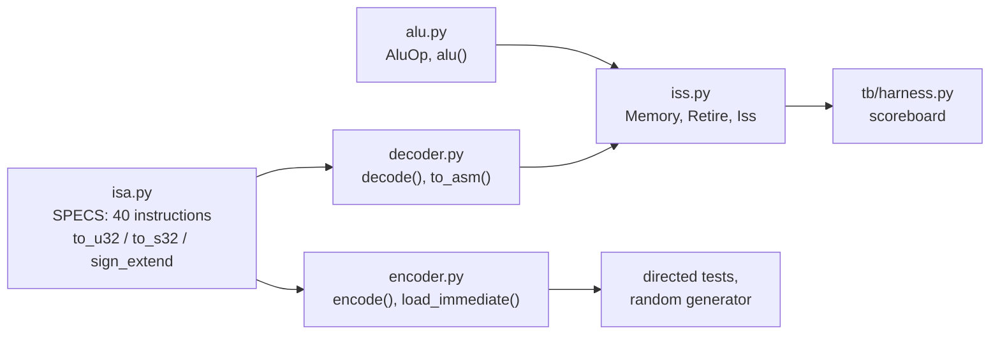
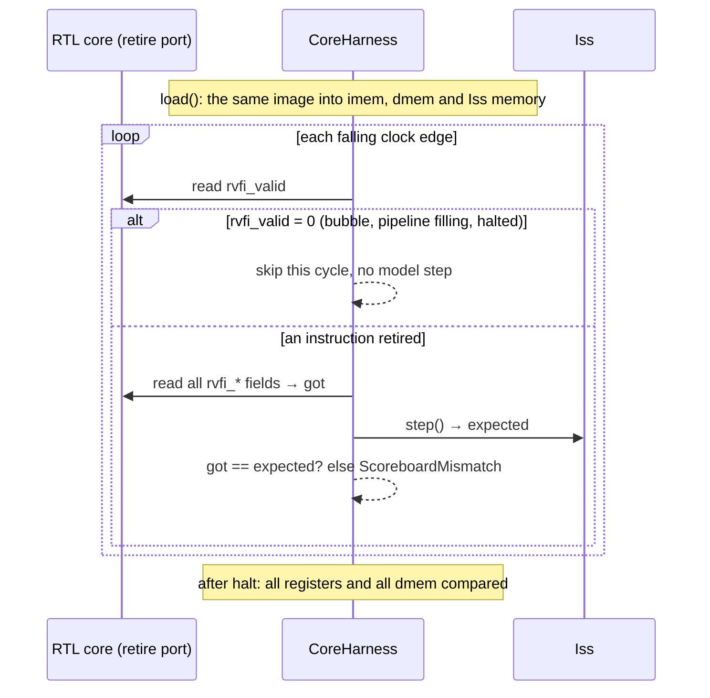

# 06 · The golden model

## What you'll learn

- What a golden model and an instruction-set simulator (ISS) are, and why verification
  needs one.
- How `model/` is organised: one instruction table feeding an encoder, a decoder, a
  reference ALU and the ISS.
- Exactly what `Iss.step()` does for one instruction, and what the `Retire` record it
  returns means.
- How the model stays in **lockstep** with the RTL, even with the pipelined core, which
  finishes instructions on different cycles.
- How the model itself was verified (429 tests), and what risk is left.

---

## 1. A worked example first

This is real output, from running four instructions through the ISS in Python:

```python
from model.encoder import encode as e
from model.iss import Iss, Memory

mem = Memory(0x4000)
mem.load_words(
    [
        e("addi", rd=1, imm=5),
        e("addi", rd=2, rs1=1, imm=1),
        e("sw", rs1=0, rs2=2, imm=0x100),
        e("ecall"),
    ],
    0,
)
iss = Iss(mem)
for _ in range(4):
    print(iss.step())
```

```
Retire(pc=0, insn=5243027, next_pc=4, rd=1, rd_wdata=5, mem_addr=0, mem_rmask=0, mem_wdata=0, mem_wmask=0, halt=False)
Retire(pc=4, insn=1081619, next_pc=8, rd=2, rd_wdata=6, mem_addr=0, mem_rmask=0, mem_wdata=0, mem_wmask=0, halt=False)
Retire(pc=8, insn=270540835, next_pc=12, rd=0, rd_wdata=0, mem_addr=256, mem_rmask=0, mem_wdata=6, mem_wmask=15, halt=False)
Retire(pc=12, insn=115, next_pc=12, rd=0, rd_wdata=0, mem_addr=0, mem_rmask=0, mem_wdata=0, mem_wmask=0, halt=True)
```

Each `step()` executes exactly one instruction and returns a record of **everything it
changed**:

- **Row 1:** `addi x1, x0, 5`. Here `insn` = 5243027 = `0x00500093`, the word from
  chapter 01.
- **Row 2:** writes x2 = 6.
- **Row 3:** `sw` writes no register (rd = 0), but stores 6 at word address 0x100 (256)
  with all four bytes enabled (mask 15 = `0b1111`).
- **Row 4:** `ecall` halts. It reports `halt=True`, and its `next_pc` stays at its own pc.

This record is the same thing the RTL reports on its retire port, every cycle an
instruction finishes. Comparing the two is the heart of the project (chapter 07).

## 2. What a golden model is

A **golden model** (also called a **reference model**) is an independent description of
what the design *should* do. It's written to be obviously correct rather than fast or
hardware-like. The testbench trusts it as the source of right answers.

For a CPU, the natural golden model is an **instruction-set simulator (ISS)**: a program
that keeps the architectural state and executes instructions one at a time, exactly as the
ISA specifies. The **architectural state** is what software can see: the registers, the
pc and memory.

**An ISS has no notion of cycles, pipelines or forwarding.** That's what makes it a good
reference for *both* cores.

Industry projects often use **Spike**, the official RISC-V ISS. This project writes its own
in Python, about 180 lines (`model/iss.py`). The README gives the reason: every line
is explainable, and it produces exactly the per-instruction record needed. The risk that
creates, and how it's reduced, is in section 6.

## 3. The files in `model/`



| File | Key contents | Lines |
|---|---|---|
| `model/isa.py` | `SPECS`, one `InstrSpec(name, fmt, opcode, funct3, funct7)` per instruction; the encoder, decoder and tests all read this one table | `67-114` |
| | `to_u32` (wrap to 32 bits), `to_s32` (read as signed), `sign_extend(value, bits)` | `14-29` |
| `model/encoder.py` | `encode(name, rd, rs1, rs2, imm)` builds a machine word and checks every range (registers 0–31, immediates per format, even branch offsets) | `34-100` |
| | `load_immediate(rd, value)`, the `li` pseudo-instruction (chapter 02) | `103-117` |
| `model/decoder.py` | `decode(word)` looks up `(opcode, funct3, funct7)` in `_LOOKUP` (built from `SPECS`), then extracts fields per format; raises `IllegalInstruction` for anything else | `45-100` |
| | `to_asm(instr)` prints GNU assembler syntax; used in error messages and the waveform | `103-124` |
| `model/alu.py` | `AluOp` with the same numbers as the RTL enum; `alu(op, a, b)` | `8-46` |
| `model/iss.py` | `Memory`, `Retire`, `Iss` | `23-184` |

### Python integers and 32 bits

Python integers never overflow: `0xFFFFFFFF + 1` is `0x100000000`. Hardware registers
wrap. So the model wraps explicitly after every operation that could overflow, with
`to_u32(x) = x & 0xFFFFFFFF` (`model/isa.py:14-16`). It reads a value as signed only
when an instruction needs that, with `to_s32` (`model/isa.py:19-22`).

Example: `alu(AluOp.ADD, 0x7FFFFFFF, 1)` returns `0x80000000`, a signed overflow
wrapping just like hardware (`tests/model/test_alu_model.py:13`).

## 4. Inside `Iss.step()`

`model/iss.py:106-175`, step by step:

1. **Refuse to run after halting** (`107-108`), and reject a misaligned pc (`110-111`).
2. **Fetch and decode** (`112-113`): `insn = mem.load(pc, 4)`, then `i = decode(insn)`.
   An illegal word raises `IllegalInstruction` here.
3. **Read both source registers** (`114-115`), whether or not the instruction uses them.
   This is harmless: they're just Python list reads.
4. **Set defaults** (`117-120`): `next_pc = pc + 4`, no register result, no memory access.
5. **Execute by instruction group** (`122-161`), one `if`/`elif` chain:

   | Group | Lines | What it computes |
   |---|---|---|
   | ALU (19 instructions) | `122-124` | `alu(ALU_OPS[name], rs1, rs2 or imm)`. `ALU_OPS` maps every name to an `AluOp` (`77-84`) |
   | `lui` / `auipc` | `125-128` | `imm << 12`, and `pc + (imm << 12)` |
   | `jal` / `jalr` | `129-134` | link = pc + 4; target, with bit 0 cleared for `jalr` |
   | branches | `135-137` | `BRANCH_TAKEN[name](rs1, rs2)`: six lambdas (`86-93`) |
   | loads | `138-146` | address = rs1 + imm; alignment check; `mem.load(addr, nbytes, signed)`; word-aligned `mem_addr` and the byte `mem_rmask` |
   | stores | `147-156` | the same, plus `mem_wdata` already shifted into its byte lane, as on the hardware bus |
   | `fence` | `157-158` | nothing |
   | `ecall` / `ebreak` | `159-161` | `halt = True`, `next_pc = pc` |

6. **Reject a misaligned jump or branch target** (`163-164`).
7. **Write the destination register, never x0** (`166-169`). The Retire record says
   `rd = 0, rd_wdata = 0` when nothing is written. That includes writes to x0.
8. **Commit** `pc` and `halted`, and return the `Retire` record (`171-175`).

### The `Retire` record: the contract with the RTL

`model/iss.py:53-74` defines the fields, with their conventions spelled out in the docstring:

| Field | Meaning | Convention |
|---|---|---|
| `pc`, `insn`, `next_pc` | where it was, what it was, where it went | `next_pc` shows branch decisions and jump targets |
| `rd`, `rd_wdata` | register written and value | both 0 if no write, including writes to x0 |
| `mem_addr` | load/store address | **word-aligned**, else 0 |
| `mem_rmask` / `mem_wmask` | bytes read / written, bit i = byte lane i | 0 if none |
| `mem_wdata` | store data | **already shifted into its lane**, else 0 |
| `halt` | ECALL/EBREAK | |

These conventions follow **RVFI**, the RISC-V Formal Interface, a standard way for a core to
report retired instructions. Both cores drive matching outputs:
- `rtl/core_single.sv:153-167`;
- `rtl/core_pipe.sv:328-342`.

The record is a frozen dataclass, so `got == expected` compares every field at once
(`tb/harness.py:228`).

**Why report masks and lane-shifted data rather than "stored byte 0xDD at 0x2005"?**
Because that's what the hardware bus looks like (chapter 04's LSU). Using the hardware's
form means the RTL needs no conversion logic just for testing. The model does the small
conversion instead (`model/iss.py:153-156`).

## 5. Lockstep with the RTL

"Lockstep" here means **one model step per retired RTL instruction**. It does *not* mean
one step per clock cycle.



The code for each part of that loop:

| What keeps them in step | Code |
|---|---|
| Both start from the same memory image | `tb/harness.py:122-134` |
| Both start at pc 0 with all registers 0 | `regfile.sv:21-22` (reset); `model/iss.py:100-104` |
| The model advances only when the core retires | `tb/harness.py:170-171,179-180` |
| An instruction the model refuses (misaligned, out of range, illegal) is itself a mismatch | `tb/harness.py:222-227` |
| End state: registers 1–31 and all 4,096 data words | `tb/harness.py:238-247` |

**This is why the same model checks both cores.** The pipeline retires its first
instruction in cycle 5 and leaves gaps after stalls and flushes. The harness simply waits.
The *order* and *content* of retired instructions must be identical. The *timing* is free.

One special case: an illegal instruction on purpose. The harness checks `rvfi_trap` *before*
stepping the model (`tb/harness.py:173-177`). So in the test `illegal_instruction_traps`, the
model never tries to decode `0xFFFFFFFF`, and the test passes when the core traps.

## 6. Who verifies the verifier?

If the model is wrong, the scoreboard happily "confirms" a core with the same mistake. So
the model is tested on its own before any RTL test means anything. There are 429 tests
in `tests/model` (counts from `pytest tests/model --collect-only`):

| File | Tests | What it checks | Why it's independent of the model |
|---|---|---|---|
| `test_iss.py` | 82 | every instruction, edge cases (x0, wrap, sign extension, shifts ≥ 32, `jalr` bit 0, misaligned/out-of-range errors), `li` edge values | expected values were computed by hand |
| `test_alu_model.py` | 23 | every ALU op on overflow and sign edges | by hand |
| `test_encoder.py` | 71 | 12 known words, 200 round trips per instruction, range errors, illegal words; **1,600 random instructions assembled by GNU `as` and compared word by word** (`108-128`) | GNU `as` is an independent implementation |
| `test_programs_iss.py` | 43 | **the 40 official rv32ui riscv-tests**, plus fibonacci and bubble sort | riscv-tests check themselves; the C results are computed in plain Python (`tb/programs.py:107-130`) |
| `test_random_program.py` | 204 | 200 seeds of random programs run to ECALL on the ISS without faults; loads/stores stay in the data region | checks the generator's legality, using the model |
| `test_coverage.py` | 6 | the coverage collector counts the right bins | small hand-made programs |

### Proof that this net catches model bugs

In M3, the ISS's SRA was deliberately changed into a logical shift. The riscv-tests on the
ISS failed (`lui`, `sra`, `srai`), reporting `rv32ui-sra failed test case 3 (gp=7)`
(`docs/bugs.md`, "Injected bugs: earlier milestones").

### The remaining risk

The model and the RTL share an author. Both could encode the same misreading of the
spec. If a gap like that existed in an area the official riscv-tests don't cover, nothing
here would notice. Two mitigations are in place:
- the official tests and GNU `as` are external;
- the directed tests check `expect` register values computed by hand, independent of the
  model (`tests/rtl/test_core_directed.py:3-6,396-398`).

A stronger check would compare against Spike, or use formal verification (README, next
steps).

## Known gaps

- **Errors instead of traps.** The ISS raises Python exceptions for misaligned accesses and
  out-of-range memory (`model/iss.py:15-20`). It never models a RISC-V trap. That's
  consistent with the core, which has no trap support, but it means "what should happen on
  a misaligned load" is simply out of scope, not modelled.
- **Hand-synchronised constants.** Some values must match between Python and SystemVerilog
  but are only tied together by comments:
  - `AluOp` vs `alu_op_e` (`model/alu.py:1`, `rtl/rv32i_pkg.sv:36-37`);
  - `MEM_WORDS` (`tb/harness.py:29`);
  - `IMAGE_BYTES` (`tb/programs.py:23`);
  - `FWD_EXMEM`/`FWD_MEMWB` in the coverage code (`tb/coverage.py:61`).

  A mismatch in the ALU codes would make the ALU unit test fail. The others would only
  show up as confusing failures.
- **`fence` is a no-op in both.** That's correct for a single core with no caches
  (`model/iss.py:157-158`), but it is never really tested beyond "it doesn't break
  anything".

## Check yourself

1. Why is an ISS a good reference for *both* the single-cycle and pipelined cores?
2. What does the `Retire` record report for `sw x2, 0x100(x0)` when x2 = 6?
3. When does the harness call `iss.step()`, and when does it not?
4. Name two checks of the model that don't depend on the model's author.
5. What happens if a test program makes the model raise `MisalignedAccess`?

<details>
<summary>Answers</summary>

1. It describes architectural behaviour only, one instruction at a time, with no cycles.
   The scoreboard compares the *sequence* of retired instructions, so timing differences
   between cores don't matter.
2. rd = 0, rd_wdata = 0, mem_addr = 0x100, mem_wmask = 0b1111, mem_wdata = 6,
   next_pc = pc + 4 (section 1, row 3).
3. Once for every cycle in which `rvfi_valid = 1` and `rvfi_trap = 0`. Never on bubble
   cycles (`tb/harness.py:170-180`).
4. Any two of: GNU `as` encoding 1,600 random instructions, the official riscv-tests, the C
   programs' results recomputed in plain Python, and hand-computed values.
5. `_check` catches it and raises a `ScoreboardMismatch` reporting "golden model raised ..."
   with the pc (`tb/harness.py:222-227`). The test fails, which is right: the program
   should never do that.

</details>
