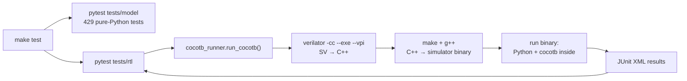

# 09 · Tooling

## What you'll learn

- What each tool is, why this project uses it, and the exact commands:
  - Verilator, cocotb, pytest, ruff;
  - the RISC-V GCC toolchain;
  - Yosys and sv2v;
  - GTKWave, matplotlib;
  - Docker, Make, GitHub Actions.
- What really happens, command by command, when you run `make test`.
- Which versions are pinned, and why some pins exist (one of them was measured, not guessed).

---

## 1. A worked example first: what `make test` actually runs

Here is the regfile unit test, with the build directory removed first so everything
happens. cocotb logs each command it runs (real output, paths shortened):

```
INFO: Running command perl /usr/bin/verilator -cc --exe -Mdir .../sim_build/regfile
      -DCOCOTB_SIM=1 --top-module regfile --vpi --public-flat-rw --prefix Vtop -o regfile
      -LDFLAGS '... -lcocotbvpi_verilator' -Wall
      .../cocotb/share/lib/verilator/verilator.cpp .../rtl/regfile.sv
INFO: Running command make -C .../sim_build/regfile -f Vtop.mk VM_TRACE=0
INFO: Running command .../sim_build/regfile/regfile
     0.00ns INFO     cocotb     Running on Verilator version 5.020 2024-01-01
```

There are three steps:

1. **Verilator translates the SystemVerilog into C++**, along with a makefile (`Vtop.mk`).
   Three options matter here:
   - `--vpi --public-flat-rw` make every signal readable and writable from outside, which
     is what cocotb needs;
   - `verilator.cpp` is cocotb's `main()`;
   - `-Wall` makes lint warnings fail the build, the same as `make lint`
     (`tests/rtl/cocotb_runner.py:48`).
2. **make + g++ compile that C++** into a native executable, `sim_build/regfile/regfile`.
   It's linked with cocotb's VPI library.
3. **Running the executable *is* the simulation.** At start-up it loads Python, cocotb
   imports the test module, and the `@cocotb.test()` coroutines drive the design through
   VPI.

The whole `make test` repeats that for:
- `alu` and `regfile`;
- `tb_top` with the single-cycle core;
- `tb_top` with the pipelined core (three suites each).

All of that comes after the pure-Python model tests. In the `make results` run, the model
tests took 2.76 s and the RTL tests 104.48 s.



## 2. Versions

All measured on the development machine (WSL2 Ubuntu 24.04). The same apt packages are used
in Docker and CI.

| Tool | Version | Installed by | Pinned where |
|---|---|---|---|
| Python | 3.12.3 | Ubuntu | — |
| Verilator | 5.020 | apt | Ubuntu 24.04's package |
| Yosys | 0.33 | apt | Ubuntu 24.04's package |
| riscv64-unknown-elf-gcc | 13.2.0 | apt | Ubuntu 24.04's package |
| sv2v | v0.0.13 | `tools/install_sv2v.sh` | version and SHA-256 (`tools/install_sv2v.sh:10-11`) |
| GTKWave | 3.3.116 | apt (local only) | — |
| cocotb | 1.9.2 | pip | `requirements.txt:4` |
| pytest | 9.1.1 | pip | `requirements.txt:6` |
| ruff | 0.17.1 | pip | `requirements.txt:8` |
| matplotlib | 3.10.7 | pip | `requirements.txt:11` |

**Why cocotb is held at 1.9.x:** cocotb 2.x requires Verilator ≥ 5.036, and Ubuntu 24.04
ships 5.020 (`requirements.txt:2-3`). This was measured during M1: cocotb 2 refuses to run
on 5.020. It wasn't assumed.

## 3. Verilator: the simulator

**What it is.** An open-source SystemVerilog **simulator**. It runs the design's behaviour
on your computer. Unlike event-driven simulators (Questa, VCS, Xcelium, Icarus), Verilator
*compiles* the design into C++. That makes it very fast. It also only supports the
synthesizable subset of the language, plus some testbench constructs, and treats signals
as 2-state (0/1) by default.

**Two uses here:**

| Use | Command | Where |
|---|---|---|
| **Lint**: static checks with no simulation (unused signals, width mismatches, latches, …) | `verilator --lint-only -Wall --top-module <top> <files>` | `Makefile:56-60` |
| **Simulation** through cocotb | the `-cc --exe --vpi` command above | `tests/rtl/cocotb_runner.py:43-51` |

`make lint-rtl` lints six configurations (`make -n lint-rtl`):
- `alu`, `regfile`, `core_single` and `core_pipe`;
- `tb_top`, once without `-DPIPELINED` and once with it.

The Makefile does this with a **pattern rule**, `lint-rtl-%`, where `$*` is the top name
and `LINT_$*` its file list (`Makefile:11-19,54-60`).

**Waveforms.** With `WAVES=1`, the runner passes `waves=True` (`tests/rtl/cocotb_runner.py:41`).
cocotb then adds `--trace`, and the simulator writes `dump.vcd` into the build directory.
For example: `make test-random CORE=pipe SEED_START=7 SEEDS=1 WAVES=1`.

**One Verilator limitation shaped the code:** cocotb 1.9 cannot look inside `generate`
blocks in Verilator 5.020 ("VPI: Not able to map type vpiScope"). That's why `tb_top`
selects the core with `` `ifdef `` (`tb/tb_top.sv:5-6`).

## 4. cocotb: Python testbenches

**What it is.** A framework for writing testbenches in **Python** instead of SystemVerilog.
It runs inside the simulator and talks to the design through **VPI** (Verilog Procedural
Interface), the standard C API simulators expose.

The concepts you need:

| Concept | Meaning | Example in this repo |
|---|---|---|
| `dut` | handle to the top-level module; `dut.x` reaches signal `x`, `dut.u_core.y` goes down the hierarchy | `self.core = dut.u_core` (`tb/harness.py:100`) |
| `.value` | read or write a signal | `dut.rst_n.value = 0`; `int(dut.rvfi_pc.value)` (`tb/harness.py:140,209`) |
| `@cocotb.test()` | marks an `async def` as a test | `tests/rtl/test_alu.py:32-38` |
| `await RisingEdge(clk)` / `FallingEdge` / `Timer` | pause the coroutine until that event in simulated time | `tb/harness.py:159` |
| `Clock` | a background coroutine toggling a signal | `Clock(self.dut.clk, 10, units="ns")` (`tb/harness.py:138`) |
| `cocotb.start_soon` | start a coroutine in the background | `tb/harness.py:138` |
| plusargs | `+NAME=value` simulator arguments, readable as `cocotb.plusargs` | `+CORE=pipe` (`tb/harness.py:45`) |
| runner | Python API that builds and runs a simulation (`cocotb.runner.get_runner`, marked experimental in 1.9) | `tests/rtl/cocotb_runner.py:43-60` |

**Why sample on the falling edge?** The design changes state on rising edges. Halfway
between them, all combinational logic has settled. Reading the retire port at the falling
edge always sees a stable, complete record of the instruction committing at the next
rising edge (`tb/harness.py:8-9`).

**Writing memories directly.** `self.dut.imem[index].value = word` (`tb/harness.py:129`)
writes the testbench's memory array through VPI. That's how programs are loaded with no
loader hardware at all.

**Quirks found and handled (cocotb 1.9.2):**
- **The runner merges environments the wrong way round.** It copies `os.environ` over
  `extra_env`, which led to chapter 08's bug 1. The fix: pass settings as plusargs
  (`tests/rtl/cocotb_runner.py:31-37`).
- **The results file has a strange name under pytest:** `sim_build/<build>/<pytest test
  id>.None`, for example `test_core_directed[pipe].None` (`CLAUDE.md:83`). The test report
  and the mutation tool read those files (`tools/test_report.py:45`,
  `tools/mutation_analysis.py:24-25`).
- **Outside a simulation, `cocotb.plusargs` is `None`.** pytest imports the test modules
  too, outside any simulator, so `core_name()` uses `cocotb.plusargs or {}`
  (`tb/harness.py:40-45`).
- **`TESTCASE=<name>` runs a single cocotb test.** The waveform tool uses it
  (`tools/failing_waveform.py:46`).

## 5. pytest and ruff

**pytest** is Python's standard test runner. Here it does two jobs:

1. **It runs the 429 pure-Python model tests** directly (`tests/model/`).
   `@pytest.mark.parametrize` generates one test per case, for example one per instruction
   (`tests/model/test_encoder.py:61-66`).
2. **It launches the cocotb simulations.** Each `tests/rtl/test_*.py` has a plain function
   such as `test_core_directed(core)` that calls `run_cocotb` (`tests/rtl/test_core_directed.py:414-416`).
   If any cocotb test inside fails, the runner raises and pytest reports one failure for
   the whole suite.

Configuration lives in `pyproject.toml:7-14`:
- `pythonpath = ["."]` lets tests `import model`;
- `testpaths = ["tests"]`;
- one filter for cocotb's "experimental runner" warning.

**ruff** is a Python linter and formatter in one tool (`make lint-py`, `Makefile:50-52`).
Its rules, line length 100 and the excluded folders are in `pyproject.toml:16-26`.

## 6. The RISC-V GCC toolchain

`riscv64-unknown-elf-gcc` is a cross-compiler: it runs on x86 and emits RISC-V code.
Despite the name, `-march=rv32i -mabi=ilp32` makes it produce 32-bit RV32I code.

It has three uses:

| Use | Code |
|---|---|
| Build the 40 riscv-tests and 2 C programs into memory images | `tb/programs.py:25-37` (flags), `56-72` (link, then `objcopy -O binary`, then words) |
| Cross-check the encoder against GNU `as` on 1,600 instructions | `tests/model/test_encoder.py:107-128` |
| Nothing else: directed and random tests are encoded by `model/encoder.py`, with no assembler | — |

**Flags worth knowing** (`tb/programs.py:25-37`):

| Flag | Why |
|---|---|
| `-nostdlib -nostartfiles` | no C library and no OS startup; `programs/crt0.S` is the whole startup |
| `-mno-relax` | stop the linker from rewriting instructions, so every instruction is exactly as written |
| `-fno-tree-loop-distribute-patterns` | stop GCC turning loops into `memset`/`memcpy` calls that don't exist here |
| `-msmall-data-limit=0` | no gp-relative data, because `crt0.S` doesn't set up `gp` |
| `-Werror` | C warnings fail the build |

Builds are cached in `build/` and redone only when a source is newer
(`tb/programs.py:50-60`).

## 7. Yosys and sv2v: synthesis

**What synthesis is.** It translates RTL into a **netlist**: a list of real logic cells
(gates, flip-flops, or an FPGA's LUTs) and the wires between them. It tells you how big the
design is. With timing data, it can also tell you how fast the design is; this project
doesn't do that part.

**Yosys** is the standard open-source synthesis tool. `make synth` runs
`tools/synth_report.py`, which does three things for each core:

1. **Convert to Verilog-2005 with sv2v** (`tools/synth_report.py:39-45`). Yosys 0.33 rejects
   two constructs this RTL uses:
   - package imports in module headers (`rtl/alu.sv:3: ERROR: syntax error`);
   - the `inside` operator.

   **sv2v** is a converter from SystemVerilog to plain Verilog. It's used *only* for
   synthesis; simulation and lint read the original files (`tools/install_sv2v.sh:5-7`).
2. **Run Yosys twice** (`tools/synth_report.py:23,47-57`):
   - `synth -flatten -top <core>`: generic, technology-independent cells (`$_AND_`,
     `$_MUX_`, `$_SDFFCE_`…);
   - `synth_xilinx -flatten -top <core>`: Xilinx 7-series FPGA primitives (LUT1–6, FDRE
     flip-flops, CARRY4, MUXF7/8), with no vendor tools needed.

   `-flatten` merges the submodules into one, so the counts cover the whole core.
3. **Parse `stat`'s output and enforce clean synthesis.** Any line starting with
   `Warning` fails the run, and so does any inferred latch (`tools/synth_report.py:52-56,63`).
   ABC, the logic optimiser Yosys calls, prints "ABC: Warning: The network is combinational".
   That message is informational, so it's deliberately excluded.

The results go to `build/results/synth.json` and the README table (chapter 10). CI runs
`make synth` on every push, so a change that makes the RTL unsynthesizable fails the build
(`.github/workflows/ci.yml:43-44`).

To install sv2v: `bash tools/install_sv2v.sh`. It downloads the pinned release, checks its
SHA-256, and installs to `~/.local/bin` (`tools/install_sv2v.sh:10-22`). `synth_report.py`
also looks there (`tools/synth_report.py:26-31`).

## 8. GTKWave and the waveform image

**GTKWave** is a viewer for waveform files: VCD (Value Change Dump) or FST. After a run with
`WAVES=1`:

```bash
gtkwave sim_build/tb_top_pipe/dump.vcd
```

On WSL2 this opens a window through WSLg. Signals live under `TOP → tb_top → u_core`. The
pipeline registers appear as single wide vectors, because they're packed structs.

**`make waveform` doesn't use GTKWave.** `tools/failing_waveform.py` has its own minimal
VCD reader (`54-87`) and draws the PNG with **matplotlib**. That keeps the README image
reproducible instead of a hand-made screenshot. The reason is recorded in
`requirements.txt:9-10`.

## 9. Make: the command layer

The Makefile is the single entry point. `make help` lists the targets (`Makefile:24-41`).

| Target | Does | Lines |
|---|---|---|
| `venv` | create `.venv`, install `requirements.txt` | `43-46` |
| `lint` | `lint-py` (ruff check + format check) and `lint-rtl` (6 Verilator lints) | `48-60` |
| `format` | auto-format Python | `62-64` |
| `test` | `test-model` + `test-rtl` | `66-72` |
| `test-random` | only the random suite | `74-76` |
| `coverage`, `cpi` | reports from the last test run | `78-82` |
| `mutation`, `synth`, `waveform`, `plots`, `test-report` | the tools in `tools/` | `84-98` |
| `results` | clean, then everything above, in a fixed order | `100-112` |
| `docker-test` | build the image and run it | `114-116` |
| `clean` | delete `sim_build`, `build`, `.pytest_cache` | `118-119` |

**Two details:**

- **Test knobs are exported to pytest.** `export CORE SEEDS SEED_START SEED WAVES`
  (`Makefile:6`) means `make test CORE=pipe` reaches the Python code as an environment
  variable. An *unset* knob is exported as an empty string, so the Python side always
  reads them as `os.environ.get("X") or default` (`tests/rtl/test_core_random.py:21-23`).
- **Which Python runs.** `PYTHON` is `.venv/bin/python` if it exists, otherwise `python3`
  (`Makefile:8`). The same Makefile therefore works locally, in Docker and in CI.

## 10. Docker: a reproducible machine

A **Docker image** is a frozen Linux filesystem with all the tools installed. A
**container** is a running copy of it. This project's image (`Dockerfile`) is built in five
steps:

1. Start from `ubuntu:24.04` (`Dockerfile:4`).
2. `apt-get install` the build tools, Python, Verilator, the RISC-V GCC, Yosys and curl
   (`Dockerfile:12-20`).
3. Install sv2v with the same pinned script (`Dockerfile:23-24`).
4. Create `/opt/venv` with `requirements.txt` (`Dockerfile:27-30`). This step comes before
   copying the source, so editing code doesn't reinstall Python packages: Docker's layer
   cache.
5. Copy the repo and run `make lint test synth` (`Dockerfile:32-35`).

```bash
docker build -t rv32i-core-verif .
docker run --rm rv32i-core-verif
```

`.dockerignore` keeps `.git`, `.venv` and the build folders out of the image.

## 11. GitHub Actions: continuous integration

**CI** (continuous integration) runs the checks on a clean machine for every push and pull
request, so "works on my machine" can't hide a broken build. The workflow is
`.github/workflows/ci.yml`. It has two jobs that run in parallel:

| Job | Steps | Lines |
|---|---|---|
| `lint-and-test` | check out with submodules → apt install Verilator, GCC, Yosys + `install_sv2v.sh` → print versions → `make venv` → `make lint` → `make test` → `make synth` → `make plots waveform` | `12-47` |
| `docker` | check out → `docker build` → `docker run` (lint + test + synth inside the image) | `49-61` |

`submodules: true` matters: without it, `third_party/riscv-tests` would be empty
(`.github/workflows/ci.yml:16-18`).

The README's badge shows the latest result on `main`. Each milestone was merged only after
both jobs passed.

## Known gaps

- **`make help` and the README disagree on how long `make results` takes:** "~10 min" vs
  "~7 min" (`Makefile:39`). The measured run took 406 s.
- **`CLAUDE.md:55` is stale.** It still says `docker-test` runs `make lint test`; the image
  now runs `make lint test synth` (`Dockerfile:35`).
- **apt packages aren't pinned to exact versions.** CI gets whatever Ubuntu 24.04 ships that
  day. The versions above are the ones measured; a future Ubuntu update could change them.
- **Docker wasn't run on the development machine** (WSL integration was off). The Docker
  build is verified only by the CI `docker` job.
- **`tools/mutation_analysis.py:28` has an unused parameter.** `run_suite` takes an
  `extra_env` argument that no caller passes.

## Check yourself

1. What are the three commands cocotb's runner executes for one RTL test?
2. Why can't this project use cocotb 2.x?
3. Why does synthesis go through sv2v, and does simulation use sv2v's output?
4. How does `make test CORE=pipe` reach the Python test code?
5. What do the two CI jobs check that the other doesn't?

<details>
<summary>Answers</summary>

1. `verilator -cc --exe --vpi ...` (SystemVerilog to C++), `make -f Vtop.mk` (compile), and
   running the produced binary (the simulation, with cocotb inside).
2. cocotb 2.x needs Verilator ≥ 5.036, and Ubuntu 24.04 ships 5.020 (`requirements.txt:2-3`).
3. Yosys 0.33 can't parse module-header package imports or `inside`. sv2v converts the RTL
   to Verilog-2005 for synthesis only. Lint and simulation read the original SystemVerilog.
4. The Makefile exports `CORE` (`Makefile:6`). `cores_under_test()` reads it
   (`tests/rtl/cocotb_runner.py:18-25`), then the runner passes `+CORE=pipe` into the
   simulation.
5. `lint-and-test` also runs the results scripts (`make plots waveform`). `docker` proves
   the Dockerfile builds and the same checks pass inside the image.

</details>
